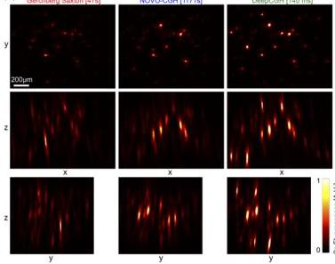
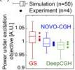
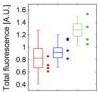
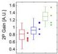

Research Article

Vol. 28, No. 18 / 31 August 2020 / Optics Express 26646

Optics EXPRESS

dimensions of the 3D fluorescent spots and therefore the achievable spatial resolution are not significantly affected by the choice of a different algorithm for hologram synthesis.

An example maximum projection image for our largest model (m = 1024 and p = 11) is shown in Fig. 5(a). Experimental results show that DeepCGH enables precise targeting of cell-sized objects randomly placed in a cube of 700μm edge size (see Supplementary Visualization 4 for co-aligned 3D tomographic reconstructions and animated projection views) and yields substantially more multiphoton absorption than iterative algorithms with the same amount of laser power. We measured the total optical power under the microscope objective for each SLM phase mask (Fig. 5(b), top) using a power meter (Thorlabs PM100). We observed small fluctuations of optical power (less than 1% on average) attributed to losses in the optical path and variable amounts of undiffracted light (blocked by the reverse pinhole) that are specific to each SLM phase mask. We computed the total amount of two-photon absorption in each 3D image by integrating the fluorescence signal across the volume of interest (Fig. 5(b), center).

(a)

(b)

Fig. 5. (a) Maximum projection images from 3D recordings of two-photon fluorescence for holograms generated with GS, NOVO-CGH, and DeepCGH. The target intensity distribution and laser power is identical across all recordings. (b) Simulation (box-plots, n=50) and experimental (n=4) measurements of the total power under the objective (top), and total two-photon fluorescence signal in the 3D volume (center). Normalized two-photon gain defined as total fluorescence divided by the square of the intensity under the objective (bottom).

To quantify the bulk gains in multiphoton absorption at equal levels of energy under the objective (i.e. heat deposition), we measured the two-photon efficiency ratio (Fig. 5(b), bottom) by dividing the total amount of two-photon fluorescence by the square of the laser power under the objective. In addition to experimental results (data points), we also display estimated values of the same quantities from simulations on n = 50 holograms of the similar type (box plots).

Simulation results indicate that 3D holograms synthesized with DeepCGH have greater accuracy than existing methods. Hence, the resulting illumination patterns better concentrate photons into the targets that are more likely to undergo multiphoton absorption. Our experimental results confirm this prediction, showing that DeepCGH holograms can yield 50% more multiphoton