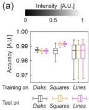
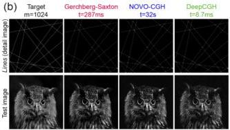

Research Article

Vol. 28, No. 18/31 August 2020 / Optics Express 26647

Optics EXPRESS

absorption with the same amount of optical power under the objective. This substantial gain in performance directly benefits applications in biology and neuroscience by increasing two-photon photo-activation without additional tissue heating or photodamage.

### 3.3. Model generalizability

A CNN model is considered generalizable when it not overfitting to the dataset on which it was trained and is able to compute accurate results from previously unseen data. By this definition, DeepCGH is generalizable if a trained model can compute equally high-fidelity holograms of new unseen shapes that are not representative of the training image dataset.

Generalizability is a valuable feature for learning-based CGH algorithms, especially for experimental settings where some variability in target distributions is expected. For instance, in holographic optogenetics applications, the exact shape of neurons depends on the brain region being considered with slight variations specific to each animal. Training a separate model for each sample would be inefficient and time consuming.

To evaluate the generalizability of DeepCGH, we compared the accuracy of simulated DeepCGH holograms for models trained and tested on different types of data. We considered three datasets of 2D images with resolution m = 512 each with a random number of disks, squares, or lines randomly placed in the image field. We trained, and tested DeepCGH on all the nine possible combinations of training and testing datasets.

Accuracy measurements with 1,000 test samples of each data type are shown in Fig. 6(a). The accuracy of DeepCGH slightly decreases when the model is tested on a type of image data that differs from what the model was trained on. However, this drop in accuracy is insignificant (less than 0.5% in all cases). Simulation results also show that the squares model performs better than the lines model when tested with the lines data set. We believe that this could be due to the increased diversity of shapes in the squares data compared to the lines data. Image diversity helps the CNN explore a wider range of the manifold that represents the mapping from target intensities to complex field at z = 0. As a result, the CNN learns a mapping that is more generalized compared to models trained with the lines model. In some applications, one can also choose to purposefully overfit the model to a specific data type and tailor the cost function to favor a particular outcome with additional gains in performance.

Fig. 6. (a) Comparison of the accuracy of simulated DeepCGH reconstructions when the model is trained (on 30,000 samples), then tested (on 1,000 samples) on three distinct image data sets made of either randomized disks, squares, or lines. (b) Example target intensities and reconstructions for GS, NOVO-CGH, and DeepCGH (trained on the Lines dataset) tested on line image (top) and a natural image (bottom). Line image is zoomed in to show detail.