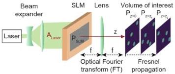

Research Article

Vol. 28, No. 18/31 August 2020 / Optics Express 26638

Optics EXPRESS

CGH application in neural photostimulation with a holographic multiphoton microscope and demonstrate enhanced two-photon absorption in holograms generated with DeepCGH.

## 2. Methods

### 2.1. Optical setup

Our CGH setup is based on the standard Fourier holography configuration shown in Fig. 1. A collimated laser beam propagating along the optical axis, z, illuminates the active surface of an SLM with a static amplitude profile, $A_{Laser}(x,y)$. A computer controlling the SLM applies a custom phase pattern, $\phi_{SLM}(x,y)$, to the laser beam. The modulated complex wave, $P_{SLM}(x,y) = A_{Laser}(x,y)e^{i\phi_{SLM}(x,y)}$, propagates through the optical system that consists of a single lens and renders a volumetric image that is defined by its complex field, $P(x,y,z)$, in the image space. We define the center of this image, z = 0, at a distance f from the other side of the lens. In this f-f configuration, the task of a CGH algorithm is to identify the phase modulation, $\phi_{SLM}$, for which $|P(x,y,z)|^2$ best matches the desired target intensity distribution.

Fig. 1. Optical set up for Fourier holography. A SLM modulates a collimated coherent wave in the pupil plane of a thin lens to render a 3D intensity pattern discretized as a series of parallel planes along the optical axis.

The complex field at the center of the image plane, $P(x,y,z=0)$, is a 2D “Optical” Fourier Transform (FT) of the field at the SLM plane, $P_{SLM}(x,y)$ (see Fig. 1), and is expressed using the Fraunhofer wave propagation model [25]:

$$P(x,y,z=0) = \frac{1}{i\lambda f} \iint P_{SLM}(x',y') \exp \left[ \frac{2i\pi(xx' + yy')}{\lambda f} \right] dx'dy'. \tag{1}$$

The phase and amplitude of the wave in the image plane, $P(x,y,z=0)$, fully determines the intensity distribution in the entire 3D volume. The field at any location x, y, z is determined by the Fresnel wave propagation equation [25]:

$$P(x,y,z) = \iint \frac{P(x',y',0)}{\sqrt{i\lambda z}} \exp \left[ \frac{i\pi((x-x')^2 + (y-y')^2)}{\lambda z} \right] dx'dy'. \tag{2}$$

The volume of interest is decomposed into a series of adjacent planes at predetermined depths around z = 0 (e.g. $P_{z=0}$, $P_{z=z_1}$, and $P_{z=z_2}$ in Fig. 1) and discretized into $m \times m \times p$ voxels, where m is the edge length of the square hologram and p is the number of planes defining the volume. Naturally, propagation to planes located before z = 0 correspond to negative values for z in Eq. (2). We note that our method can be implemented with any holographic setup as long as it can be modeled with a differentiable transfer function from the SLM plane to the image plane.

The SLM pixel size, $p_s$, the wavelength $\lambda$, and the focal length of the lens, f, determine the span, $L = \lambda f/p_s$, of the addressable window in the (x, y) domain.