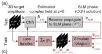
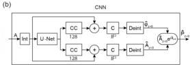
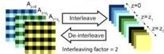
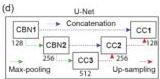
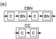

Research Article

Vol. 28, No. 18/31 August 2020 / Optics Express 26639

Optics EXPRESS

### 2.2. DeepCGH algorithm

Our algorithm is shown in Fig. 2(a). Input 3D target amplitudes, $A(x, y, z)$, consist of a multi-channel image with edges size of $m$ and $p$ channels that correspond to each depth plane. A trained CNN maps the target amplitude, $A(x, y, z)$, to a feasible approximation of the desired illumination pattern in the image plane by estimating the complex field at $z = 0$, $\hat{P}(x, y, z = 0)$. The complex field is then virtually propagated back to the SLM plane with an inverse 2D Fourier transform (Eq. (1)) to yield the solution to the CGH problem, i.e. SLM phase mask $\varphi_{SLM}$.

Fig. 2. DeepCGH algorithm. (a) A trained CNN estimates the complex field in the image plane at $z = 0$, $\hat{P}_{z=0}$, which is then reverse propagated to the SLM plane to yield the solution of the CGH problem, $\varphi_{SLM}$. During training of the CNN, the objective is to maximize the fidelity of the simulated illumination pattern, $\hat{A}$, that results from the estimated SLM phase. (b) CNN structure for DeepCGH. A plus sign, +, represents concatenation of the tensors along the channel dimension. $C$ and $CC$ indicate one and two convolutional layers respectively. The number of convolutional kernels is shown below each convolutional layer. Interleaving (Int) and De-interleaving (Deint) modules reshape the input and output of the CNN. Phase and amplitude are predicted by two separate paths. (c) The interleave module reduces the spatial dimensions of the network input without losing information by rearranging the pixels of the original input into multi-channel images of smaller size. The de-interleave module performs the inverse operation. (d) The U-Net model contains two types of convolutional blocks, CCn and CBNn, where $n$ denotes the block number. The number of convolutional kernels is denoted below each convolutional block. (e) CCn and CBNn convolutional blocks, with convolutional, $C$ and batch-normalization, $BN$, layers.

In this configuration, termed image plane holography, the input and output of the CNN share significant spatial correspondence, which simplifies the mapping that the CNN performs, thereby facilitating training [26,29–31]. During operation, this two-step sequence enables fast computation of the holograms in a fixed and predictable time window that only depends on the model size (number of convolutional layers, number of kernels, and kernel size), as well as on the number of depth planes and hologram resolution.

Our algorithm is unsupervised, i.e. trained without explicitly providing the optimal solution $\varphi_{SLM}$. For training, (see Fig. 2(a) in red), we first simulate the intensity pattern that results from the predicted SLM phase, $|\hat{A}(x, y, z)|^2$, and compare this simulated hologram with the target intensity pattern $|A(x, y, z)|^2$ via an explicitly defined loss function, $\mathcal{L}(A, \hat{A})$.

To this end, we simulate the complex field that will be synthesized at the SLM plane, $P_{SLM} = A_{Laser} e^{i\varphi_{SLM}}$. We virtually propagate the resulting wave to the image plane at $z = 0$ via a FT (Eq. (1)), and then to each plane in the discretized volume via the Fresnel propagation (Eq. (2)). The CNN is trained by minimizing the loss $\mathcal{L}(A, \hat{A})$ on a large pool of sample target