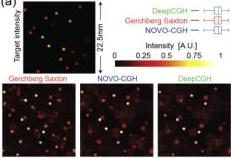
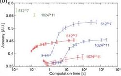
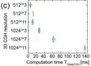
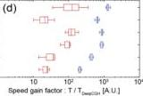
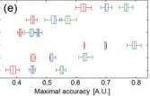

Research Article

Vol. 28, No. 18/31 August 2020 / Optics Express 26643

Optics EXPRESS

(a)

(b)

Fig. 3. Simulation results comparing DeepCGH to existing algorithms. (a) Example target distribution and simulated reconstructions of the intensity computed with GS, NOVO-CGH, and DeepCGH, at z = -30mm with SLM resolution m = 512. (b) Accuracy of the simulated 3D intensity reconstruction as a function of the computation time for holograms of size m = 512, with 7 depth planes, and m = 1024 with 11 depth planes. Computation speeds for GS and NOVO-CGH are shown for an increasing number of up to 3,500 iterations. Simulation results for six different 3D models show (c) the inference time for DeepCGH, (d) the ratio of the computation time, T, for iterative methods to reach 95% of the maximum accuracy they can reach, to the inference time of DeepCGH,  \( T_{DeepCGH} \) , and (e) the maximum achievable accuracy of iterative methods in comparison to the accuracy of DeepCGH.

algorithms fail to identify a well-matched hologram. The average accuracy values (0.47 vs 0.45 for NOVO-CGH and DeepCGH, respectively) are overall low and the observed 2% difference is not substantial. In this case, the CGH problem is more difficult with 11 consecutive intensity constraints but with less degrees of freedom due to the small SLM resolution. This is evident in the case with m = 1024 and p = 11, where, for the same number of depth planes, DeepCGH yields solutions with higher accuracy than iterative methods.

With any CGH method, the accuracy of the holograms depends on the resolution (edge size m), number of depth planes  \( (p) \) , and on the feasibility of each individual target intensity pattern (see Fig. 3(e)). For the values of m and p we selected, DeepCGH was 9% to 43% more accurate than GS, and at least 10 times faster. Compared to NOVO-CGH and excluding the case where m = 512 and p = 11, DeepCGH was between 9% to 22% more accurate and at least 200 times faster. Overall, simulation results show that DeepCGH adequately computes high fidelity 3D holograms, significantly faster and with greater accuracy than the current state of the art.

### 3.2. Experimental results

Two-photon holographic photostimulation  \( [41,42] \)  is an immediate application that directly benefits from DeepCGH. 3D CGH is routinely used to activate custom groups of neurons expressing a photosensitive opsin  \( [13,43] \) . Fast computation is necessary to elicit patterns of neural activity on demand in awake animals  \( [1] \) , and high accuracy is critical to maximize two-photon absorption by confining light into the desired targets while minimizing brain tissue heating  \( [44,45] \) . In this set of experiments, we compared 3D measurements of two-photon