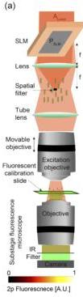
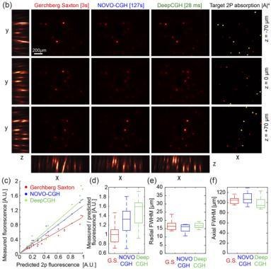

Research Article

Vol. 28, No. 18/31 August 2020 / Optics Express 26644

Optics EXPRESS

absorption in a florescent calibration slide for holograms targeting identical distributions, but generated with different CGH techniques.

Our experimental setup is shown in Figure 4(a). We integrated a Fourier holography setup into the path of a femtosecond laser beam (Coherent Monaco 1035-80-60) providing coherent illumination, $A_{Laser}$, at wavelength $\lambda = 1035\mathrm{nm}$ and collimated on a reflective liquid crystal on silicon (LCoS) SLM (Meadowlark, 1920x1152) in the pupil plane of a $f = 200\mathrm{mm}$ lens. For simplicity, Fig. 4(a) shows the reflected beam on the other side of the SLM, as with a transmissive SLM design. The undiffracted light is reduced with a reverse pinhole made by grinding a $<0.2\mathrm{mm}$ hole in the center of an optical flat. The hologram is relayed into a microscope with a 16X objective (Nikon 16x /0.8W LWD) mounted on a precision mechanical stage (Sutter MP285).

Fig. 4. (a) Experimental setup for multiphoton holography. The SLM and lens are placed in the optical path of a microscope to demagnify the hologram by a factor of 16. An ultra-fast laser provides a coherent light source, and a reverse pinhole blocks any undiffracted light. A calibration slide with a thin, uniform fluorescent film intercepts the hologram at a custom depth, $z$, and the corresponding two-photon fluorescence image is captured with sub-stage objective coupled to a camera. (b) Left, experimental measurements of fluorescence in the calibration slide observed at each of the $p = 3$ depth planes, and maximum intensity projection images along the ($y$) and ($x$) axes for holograms computed with GS, NOVO-CGH and DeepCGH and synthesized with the same amount of laser power. Right, uncompensated target two-photon absorption, $|A|^4$. (c) Two-photon fluorescence measured in $n = 20$ disks randomly picked in our experimental data as a function of the expected amount of two-photon absorption after power calibration to account for spatial dependency of the diffraction efficiency. (d) Same data as in (c) but showing the ratio of measured to predicted fluorescence. (e) Radial Full Width at Half Maximum (FWHM) for $n = 20$ randomly selected disks. (f) same as in (e) but showing axial FWHM.