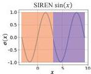
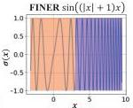
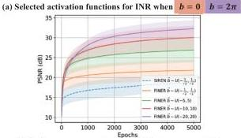

CvF

This CVPR paper is the Open Access version, provided by the Computer Vision Foundation.
Except for this watermark, it is identical to the accepted version;
the final published version of the proceedings is available on IEEE Xplore.

# FINER: Flexible spectral-bias tuning in Implicit NEural Representation by Variable-periodic Activation Functions*

Zhen Liu$^{1,\dagger}$, Hao Zhu$^{1,\dagger}$, Qi Zhang$^2$, Jingde Fu$^3$, Weibing Deng$^3$, Zhan Ma$^1$, Yanwen Guo$^4$, Xun Cao$^1$
$^1$ School of Electronic Science and Engineering, $^3$ Department of Mathematics,
$^4$ Department of Computer Science and Technology, Nanjing University, Nanjing 210023, China
$^2$ AI Lab, Tencent Company, Shenzhen 518054, China
$^\dagger$ Equal contribution. Corresponding author: caoxun@nju.edu.cn

## Abstract

Implicit Neural Representation (INR), which utilizes a neural network to map coordinate inputs to corresponding attributes, is causing a revolution in the field of signal processing. However, current INR techniques suffer from a restricted capability to tune their supported frequency set, resulting in imperfect performance when representing complex signals with multiple frequencies. We have identified that this frequency-related problem can be greatly alleviated by introducing variable-periodic activation functions, for which we propose FINER. By initializing the bias of the neural network within different ranges, sub-functions with various frequencies in the variable-periodic function are selected for activation. Consequently, the supported frequency set of FINER can be flexibly tuned, leading to improved performance in signal representation. We demonstrate the capabilities of FINER in the contexts of 2D image fitting, 3D signed distance field representation, and 5D neural radiance fields optimization, and we show that it outperforms existing INRs.

## 1. Introduction

The way a signal is represented is the foundation of all the following problems and determines the paradigm for solving them. Traditional representations, such as the image matrices, point cloud or volumes [35], focus on recording the elements individually and have offered significant contributions in history. However, this representation is increasingly inadequate for addressing the numerous inverse problems arising in modern times, such as neural rendering [35], inverse imaging [39] and simulations [14]. On the contrary, the implicit neural representation (INR) [32], which characterizes a signal by preserving

(b) Performance comparisons on 2D image representation

Figure 1. Flexible spectral-bias tuning in implicit neural representation (FINER). We observe that the supported frequency set in classical INRs is limited due to the underutilization of activation functions' definition domain, i.e., they mainly employ the central region near the origin point. To overcome this limitation, we propose a novel variable-periodic activation function for INR. This innovation allows for tuning the supported frequency set by adjusting the initialization range of the bias vector in the neural network. (a) visualizes the selected narrow activation functions in classical periodic activation $\sin(x)$ alongside our proposed variable-periodic one $\sin((|x|+1)x)$ with different bias settings. (b) plots the training curves of SIREN and FINER, demonstrating the impact of different initializations applied to the bias vector $\vec{b}$ (see Sec. 5.1.1 for more details).

the mapping function from the coordinates to corresponding attributes using neural networks, is gaining increasing attention thanks to the advantages of querying attributes continu-

*The work was supported in part by the National Natural Science Foundation of China (Grants No. 62025108, 12171237).

2713