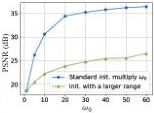

implement a multi-scale network architecture with a band-limited Fourier spectrum to minimize artifacts during the downsampling or upsampling process. However, the frequency distribution of a signal requiring inverse solving is often unknown, making it difficult to design an appropriate representation or model for the signal without prior knowledge of its frequency content.

In addition to the positional encoding with pre-defined frequency bases, there has been a growing interest in the research community for automatic frequency tuning through the use of nonlinear activation functions [4, 28, 30, 32]. [32] propose the Sinusoidal Representation Network (SIREN), a method designed to represent complex signals and functions using periodic activation functions, especially sine functions. SIREN has demonstrated its effectiveness in representing intricate details and high-frequency components when compared to traditional activation functions like ReLU or sigmoid. However, it is important to note that SIREN may necessitate careful initialization and hyperparameter tuning to achieve optimal performance. The periodic nature of sine functions can lead to oscillations and slower convergence, posing challenges in the training process. Furthermore, the size of the embedding space is limited, as the frequency distribution bias remains constant for different inputs, making it difficult to represent the diversity of frequency distributions. As a result, it is crucial to develop an adaptive periodic function for activating nonlinearity and complex frequency distribution.

### 3. FINER: Flexible spectral-bias tuning in Implicit NEural Representation

This section first provides an overview of SIREN, where the capacity-convergence gap is summarized. Then the FINER is proposed in detail.

### 3.1. SIREN and the Capacity-Convergence Gap

Pipeline of SIREN. Given a signal sequence {x⃗ᵢ, y⃗ᵢ}ᵢ₌₁ᴺ, where x⃗ᵢ and y⃗ᵢ respectively represent the coordinate and the corresponding attributes of the i-th element, N is the number of elements in the signal, SIREN focuses on pursuing a neural network f(x⃗; θ) to characterize them as accurate as possible and could be formulated as follows:

$$\vec{z}^0 = \vec{x}$$

$$\vec{z}^l = \sin(\omega_0(W^l \vec{z}^{l-1} + \vec{b}^l)), l = 1, 2, ..., L - 1,$$

$$f(\vec{x}; \theta) = W^L \vec{z}^{L-1} + \vec{b}^L \tag{1}$$

where z⃗ˡ denotes the output of layer l, θ = {Wˡ, b⃗ˡ | l = 1, 2, ..., L - 1} refers to the network parameters to be optimized, L is the number of layers, ω₀ is an empirical parameter for controlling the frequency.

Figure 2. Comparisons of SIREN for fitting a 2K image. There is a performance gap between the results of “Standard initialization multiply ω₀” and “Initialization with a larger range”.

Capacity-Convergence Gap. According to [40], the capacity of the SIREN is limited by the choice of ω₀, i.e., the functions that could be represented by f(x⃗; θ) should be able to be decomposed by a linear combination of certain harmonics of ω₀, i.e.,

$$f(\vec{x}; \theta) \in \left\{ \sum_{\omega' \in \mathcal{F}_{\omega_0}} c_{\omega'} \sin(\omega' \vec{x} + \phi_{\omega'}) \mid c_{\omega'}, \phi_{\omega'} \in Q \right\} \tag{2}$$

where Q is the set of rational number, Fω₀ is the supported frequency set defined by the ω₀. Because ω₀ only plays the role of scaling neurons, it could be removed by changing the initialization range of network parameters {Wˡ, b⃗ˡ | l = 1, ..., L - 1}. As a result, it is unnecessary to introduce the parameter ω₀ in theory.

On the other hand, since the sin function is non-convex, the network parameters should be initialized carefully to guarantee the inputs of sin mainly fall into the range of [-π, π] [32], otherwise SIREN will not converge well and does not have a high accuracy for representing signals. For example, W is often initialized from U(-√6/n, √6/n), n is the number of inputs for each neuron [32]. As a result, network parameters {Wˡ, b⃗ˡ | l = 1, ..., L - 1} could not be scaled unboundedly considering the convergence. In summary, there is a capacity-convergence gap in SIREN that,

Proposition 1 The function set that SIREN could be represented can be enlarged by increasing the initialization range of network parameters, which violates the rule of guaranteeing the convergence, resulting in a performance gap between theory and practice.

A simple example: fitting a high-resolution image. Fig. 2 compares the performance of SIREN with different initialization strategies. The blue line are the results follows the standard form of SIREN, i.e., W ~ U(-√6/n, √6/n) and an additional angular frequency ω₀ is applied to multiply the Wx⃗ + b⃗.

On the contrary, the green line refers to the performance by removing the angular frequency ω₀ in Eqn. 1 and initializing W ~ U(-ω₀√6/n, ω₀√6/n). Although they are equivalent in the mathematical form, there is a performance gap in practice.

2715