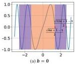
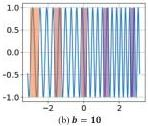

### 3.2. Variable-periodic Activation Functions

To overcome the capacity-convergence gap, SIREN introduces the parameter $\omega_0$ to enlarge the supported frequency set. However, $\omega_0$ is often set manually which poses challenges for novices and requires additional tuning process for inverse problems where the frequency distribution of the signal to be solved is unknown. To address this problem, we propose the FINER which introduces a variable-periodic activation function $\sin((|x|+1)x)$, and the Eqn. 1 could be rewritten as,

$$\begin{array}{l} \vec{y}^l = W^l \vec{z}^{l-1} + \vec{b}^l \\ \vec{z}^l = \sin(\omega_0(|\vec{y}^l| + 1)\vec{y}^l), \ l = 1, 2, ..., L - 1 \end{array} \tag{3}$$

More utilization of activation function closes the capacity-convergence gap. We notice that the periodic activation function $\sin(x)$ has an infinite definition domain while only the regions centered around the origin point are used. This underutilization of definition domain is caused by the periodic behavior of $\sin$. As shown in Fig. 1(a), because $\sin(x)$ has a period $2\pi$, the behavior after activation will not be changed when shifting the used regions to other areas, such as orange and purple boxes in Fig. 1(a) where $\vec{b} = 0$ and $2\pi$, respectively. As a result, it is unnecessary to increase the utilization rate of the definition domain in SIREN where only the central region $[-2\pi, 2\pi]$ is used [32]. Different from the periodic function $\sin(x)$, FINER adopts a variable-periodic function $\sin((|x|+1)x)$. Because the scale parameter $|x| + 1$ increases with the increase of input variable, the frequency of the used activation function will be changed when the used regions are shifted, i.e., different initialization of network parameters $\vec{b}$. As shown in Fig. 1(a), $\sin((|x|+1)x)$ for $\vec{b} = 2\pi$ has higher frequencies than itself when $\vec{b} = 0$. Thus the capacity-convergence gap could be closed by the proposed variable-periodic activation function.

### 4. Flexible Spectral-bias Initialization

In this section, we will first give the initialization scheme of FINER, then the behaviors of FINER's supported frequency set and training dynamics under different initialization are analysed from geometrical and neural tangent kernel perspectives, respectively.

### 4.1. Initialization scheme

As demonstrated in the above section, the supported frequency set of FINER could be manipulated by changing the bias $\vec{b}$. However, due to the non-convex nature of the variable-periodic activation function, there are many local minimums in $\sin((|x|+1)x)$ and gradient-based optimizations (e.g., SGD or Adam) could not guarantee moving $\vec{b}$ to

Figure 3. Comparisons of used activation function $\sin((|x|+1)x)$ under different bias $\vec{b}$. More sub-functions with high-frequency are included when $b$ is set with a larger value.

global optimum if $\vec{b}$ is not initialized well. Traditional initialization strategies, which apply uniform or Gaussian sampling in a narrow region centered at 0, makes the supported frequency set of FINER be limited by the frequency of the first cycle in variable-periodic function (i.e., the Fig. 3(a)), resulting in a waste of other cycles (Fig. 3(b)) in variable-periodic function which have difference frequencies.

To get rid of the limited supported frequency set using traditional initialization methods, we derive a novel initialization scheme for $\vec{b}$ for tuning the supported frequency set flexibly, meanwhile the initialization for $W$ follows [32]. We propose to initialize $\vec{b}$ following the uniform distribution $\mathcal{U}(-k, k)$ with a larger range $k$ than the default one in traditional methods,

$$\vec{b} \sim \mathcal{U}(-k, k), \ k > 0. \tag{4}$$

### 4.2. Geometrical Perspective

Supposing the supported frequency set of SIREN and FINER are $\mathcal{F}_{\omega_0}$ and $\mathcal{F}_{\omega_0,k}$, respectively. To analyse their relationship, let us start from the simplest case.

$k$ is close to the origin point. Because the initialization for $W$ follows [32], the term $W\vec{x}$ has similar distribution with the one in SIREN, that $|W\vec{x}| \le \pi$. As a result, the term $|(|W\vec{x}+\vec{b}|+1)(W\vec{x}+\vec{b})|$ drops into the area of $[-\pi^2 - \pi, \pi^2 + \pi]$. As shown in Fig. 3(a), the activation function $\sin((|W\vec{x}+\vec{b}|+1)(W\vec{x}+\vec{b}))$ mainly spans two narrow sub-functions with different frequencies. For the points dropped into the first sub-function (i.e., $|W\vec{x}| \le \frac{\sqrt{4\pi+1}-1}{2}$, the orange areas in Fig. 3(a)), the supported frequency set $\mathcal{F}_{\omega_0,k}^1$ is slightly larger than $\mathcal{F}_{\omega_0}$, and could be approximated as

$$\mathcal{F}_{\omega_0,k}^1 \approx \left\{ \frac{2\pi}{\sqrt{4\pi+1}-1} \omega \mid \omega \in \mathcal{F}_{\omega_0} \right\}, \tag{5}$$

where the term $\frac{2\pi}{\sqrt{4\pi+1}-1}$ measures the frequency changes from the standard $\sin$ function to the first function in $\sin((|x|+1)x)$. Considering the fact that the range $[-\pi, \pi]$ of $W\vec{x}$ is continuous, i.e., every value could be produced, the $\mathcal{F}_{\omega_0}$ is also a continuous set, as a result,

$$\mathcal{F}_{\omega_0} \subset \mathcal{F}_{\omega_0,k}^1. \tag{6}$$

2716