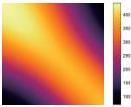
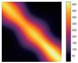
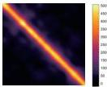
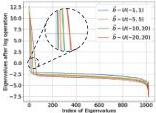

For the points dropped into the second sub-function (i.e., \(\frac{\sqrt{4\pi + 1} - 1}{2} \leq |W\vec{x}| \leq \frac{\sqrt{12\pi + 1} - 1}{2}\), the purple areas in Fig. 3(a)), the supported frequency set \(\mathcal{F}_{\omega_0,k}^2\) differs from \(\mathcal{F}_{\omega_0,k}^1\) since the base frequency of the used activation changes. Compared with the \(\mathcal{F}_{\omega_0,k}^1\) in the first sub-function, the \(\mathcal{F}_{\omega_0,k}^2\) in the second one could be approximated as,

\[
\mathcal {F} _ {\omega_ {0}, k} ^ {2} \approx \left\{\frac {\sqrt {4 \pi + 1} - 1}{\sqrt {1 2 \pi + 1} - \sqrt {4 \pi + 1}} \omega \mid \omega \in \mathcal {F} _ {\omega_ {0}, k} ^ {1} \right\}, \tag {7}
\]

where  \( \frac{\sqrt{4\pi+1}-1}{\sqrt{12\pi+1}-\sqrt{4\pi+1}} \)  characterizes the scale of frequency changes from the first sub-function to the second one. As a result, the supported frequency set  \( F_{\omega_{0},k} \)  for k is close to the origin is,

\[
\mathcal {F} _ {\omega_ {0}, k} = \mathcal {F} _ {\omega_ {0}, k} ^ {1} \cup \mathcal {F} _ {\omega_ {0}, k} ^ {2}. \tag {8}
\]

k is far away from the origin point. For example,  \( \vec{b} \)  is initialized as 10. Because the frequencies of each subfunctions are further increased for  \( \vec{b}=10 \)  (in Fig. 3(b), the frequency is increased from the orange box to purple box), the supported frequency set  \( F_{\omega_{0},k} \)  is increased a lot compared with the one in Eqn. 8. In summary,

Proposition 2 The supported frequency set  \( F_{\omega_{0},k} \)  of FINER increases with the increase of the initialization range of  \( \vec{b} \) , and the supported frequency set  \( F_{\omega_{0}} \)  of SIREN is a subset of  \( F_{\omega_{0},k} \) .

### 4.3. Neural Tangent Kernel Perspective

Neural tangent kernel (NTK) theory [12] views the training of neural network as kernel regression, where the convergence of the network on fitting signals could be derived by analysing the diagonal property of the NTK or the distribution of NTK's eigenvalues. Generally speaking, stronger diagonal property results in better shift-invariance and better convergence, larger eigenvalues leads to faster convergence for high-frequency components [1, 34].

Without loss of generality, we focus on a simple case, i.e., the signal to be learned has 1D input and 1D output and FINER has 1 hidden layer with n neurons, such a network could be written as  \( f(x;\theta)=\sum_{k=1}^{n}c_{k}\sigma(w_{k}x+b_{k}) \) , where  \( \sigma(x)=\sin((|x|+1)x) \)  is the activation function. According to the definition, the NTK of FINER could be calculated as \( ^{1} \) ,

\[
\begin{array}{l} \mathbf {K} (x _ {i}, x _ {j}) = \mathbb {E} _ {\theta} \left\langle \nabla_ {\theta} f (x _ {i}; \theta), \nabla_ {\theta} f (x _ {j}; \theta) \right\rangle \\ = \left(x _ {i} x _ {j} + 1\right) \mathbb {E} _ {\theta} \sum_ {k = 1} ^ {n} c _ {k} ^ {2} \underbrace {(2 \left| g _ {k} \left(x _ {i}\right) \right| + 1) (2 \left| g _ {k} \left(x _ {j}\right) \right| + 1)} _ {\text { Scale   term }} \\ \underbrace {\cos \left(\left(\left| g _ {k} \left(x _ {i}\right) \right| + 1\right) g _ {k} \left(x _ {i}\right)\right) \cos \left(\left(\left| g _ {k} \left(x _ {j}\right) \right| + 1\right) g _ {k} \left(x _ {j}\right)\right)} _ {\text {Sign term}} \\ \end{array}
\]

where \(g_{k}(x_{i}) = w_{k}x_{i} + b_{k}\).

(9)

\( ^{1} \) Please refer the supplemental material for details of derivation.

(a) NTK \(\vec{b}\sim U(-1,1)\)

(b) NTK \(\vec{b}\sim U(-5,5)\)

(c) NTK \(\vec{b}\sim U(-20,20)\)

(d) Eigenvalues

Figure 4. Visualizations of NTKs and the corresponding eigenvalues in FINER. (a)-(c) visualize the NTKs when \(\vec{b}\) is initialized following \(\mathcal{U}(-1,1)\), \(\mathcal{U}(-5,5)\) and \(\mathcal{U}(-20,20)\), respectively. (d) plots the corresponding eigenvalues. Because the max eigenvalue is much larger than the smallest one, all eigenvalues are processed by a log function for visualization.

It is observed that, the scale term is approximately proportional to the absolute of bias  \( b_{k} \)  for all nodes of the kernel, however the change rule of sign term for diagonal elements differs significantly from non-diagonal elements. Specifically, the sign term is always a positive value for diagonal elements while could be either positive or negative for non-diagonal elements.

As a result, the diagonal elements  \( \mathbf{K}(x_{i}, x_{i}) \)  are increased with the increase of  \( |b| \) , while the non-diagonal elements  \( \mathbf{K}(x_{i}, x_{j}) \)  can be very small, appearing as a diagonal enhanced kernel. According to [12, 34], NTK with a stronger diagonal property provides better shift-invariance, i.e., the coordinates in the training set are little coupled with each other during the training process, thus the signal could be better learned.

Figs. 4(a)-(c) visualize the NTKs of FINER for learning a 1D signal with 1024 coordinates. It is observed that the diagonal property of NTK is enhanced with the increase of initialization range of \( b \), verifying the analysis mentioned above. Fig. 4(d) visualizes the changes of eigenvalue distribution, it is observed that the number of eigenvalues which are larger than \( 10^0 \) is significantly increased when larger initialization range is applied to bias. As a result, FINER provides high capacity for learning high-frequency components.

## 5. Experiments

To verify the behaviors and performance of FINER, three experiments are conducted, including the 2D image fitting, 3D signed distance field representation and the 5D neural

2717