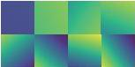
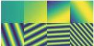

GT

SIREN \(\vec{b}\sim U(-\frac{1}{\sqrt{2}},\frac{1}{\sqrt{2}})\)

FINER \(\vec{b}\sim U(-\frac{1}{\sqrt{2}},\frac{1}{\sqrt{2}})\)

FINER \(\vec{b}\sim U(-5,5)\)

FINER \(\vec{b}\sim U(-10,10)\)

FINER \(\vec{b}\sim U(-20,20)\)

Figure 5. Comparisons of SIREN and FINER with different initializations applied to bias vector \(\vec{b}\). For each image, the right-top box visualizes its Fourier spectrum.

SIREN

FINER

Figure 6. Comparisons of the first layer outputs between SIREN and FINER. For each method, the first row demonstrates 4 neurons with smallest frequencies of the first layer, and the second row refers to 4 neurons with largest frequencies.

radiance fields optimization, where the  \( \omega_{0} \)  is equal to the one in SIREN and k is set as  \( \frac{1}{\sqrt{2}} \) , 1 and  \( \frac{1}{\sqrt{3}} \) , respectively.

### 5.1. 2D Image Fitting

For the task of 2D image representation, the INR aims at learning a 2D function \( f: \mathbb{R}^2 \to \mathbb{R}^3 \) with 2D pixel location input and 3D RGB color output, the loss function is designed as the \( L_2 \) distance between the network output and the ground truth. To evaluate the performance of INR, the widely used natural dataset [34] which contains 16 images with \( 512 \times 512 \) resolution is adopted.

#### 5.1.1 FINER behaviors under different initializations

To compare the performance of FINER under different initializations better, the pre-set parameter  \( \omega_{0} \)  is set as 1 here. According to the analysis in Sec. 4, the supported frequency set of FINER increases with the initialization range of  \( \vec{b} \) . Different curves in Fig. 1(b) reflect this behavior. Fig. 5 visualizes the learned images after 5000 training epochs. In the 3rd column, because the initialization range of  \( \vec{b} \)  follows the standard method [32], FINER has a small supported frequency set, as a result, high-frequency components in the image are lost. With the increase of the initialization range,

Table 1. Quantitative comparisons on image fitting. We color code each cell as best, second best, and third best.

|  Metrics | PEMLP | Gauss | SIREN | WIRE | FINER  |
| --- | --- | --- | --- | --- | --- |
|  PSNR ↑ | 29.60 | 35.39 | 38.52 | 31.31 | 40.76  |
|  SSIM ↑ | 0.8484 | 0.9455 | 0.9724 | 0.8738 | 0.9790  |
|  LPIPS ↓ | 1.21e-1 | 1.91e-2 | 5.52e-3 | 6.45e-2 | 2.56e-3  |

the supported frequency set of FINER increases and more high-frequency details are provided from the 3rd column to the last one in Fig. 5. Additionally, as analysed by Eqn. 6, the supported frequency set of SIREN is a subset of the one in FINER, thus FINER provides more clear details than SIREN when same initializations are applied, i.e., the 2nd column vs the 3rd column in Fig. 5.

According to [40], the first layer of SIREN or FINER plays the role of frequency encoding. We visualize 8 neurons outputs from total 256 neurons in first layer from SIREN and FINER for comparison, where 4 neurons in the 1st row have the smallest frequencies and the last 4 neurons have the largest frequencies (see Fig. 6). It is observed that different neurons in SIREN encode similar frequencies, resulting in a waste of neurons. On the contrary, different neurons in FINER focus on different frequencies, therefore, better representational ability is achieved in FINER.

#### 5.1.2 Comparisons with the State-of-the-arts

We compare FINER with four classical INRs, i.e., the Fourier feature embedding (PEMLP) [23], INR with periodic activation functions (SIREN) [32], Gaussian activation functions (Gauss) [28] and wavelet activation functions (WIRE) [30]. For a fair comparison, all INRs are set with a same network configuration (3 hidden layers with 256 neurons per layer) and trained with the same Adam optimizer [16] and \( L_{2} \) loss function between the network out-

2718