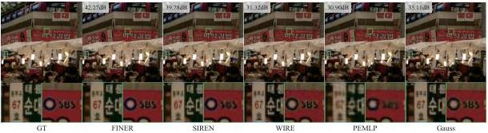
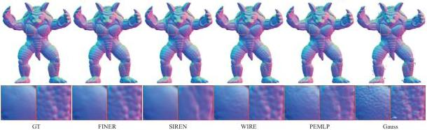

Figure 7. Qualitative comparisons between the FINER and baselines on fitting images.

Figure 8. Qualitative comparisons on representing the signed distance field of Armadillo.

put and the ground truth, other parameters are set according to the open-source codes released by authors. Tab. 1 compares FINER with others quantitatively. FINER outperforms other methods in all three metrics. Fig. 7 demonstrates the details of different methods. Among all 5 methods, FINER provides more clear results such as the texts '67' and 'SBS' in the cyan and green boxes, respectively. On the contrary, these texts are over-smoothed in the results of SIREN and PEMLP. Although WIRE and Gauss could also provide clear texts here, unwelcome serious artefacts also appear in the smooth backgrounds, such as white and red billboards.

### 5.2. 3D Shape Representation

Signed distance field (SDF) is one of the most commonly used implicit surface representations in the computer graphics [13]. As the name implies, SDF characterizes the distance from the given 3D point to the closest surface using a continuous function, and the sign of the distance is used to denote whether the point is inside (negative) or outside (positive) the surface. Recently, representing the SDF using INR is drawing more and more attention [18]. Given a 3D point \(\vec{x}\), INR learns a 3D mapping function \(f: \mathbb{R}^3 \to \mathbb{R}^1\) to output the signed distance field values \(s\). We apply the FINER to this task and compare to four classical INRs mentioned above. In the experiment, 5 shapes from public dataset [17, 24] are used for evaluation. For a fair com-

Table 2. Quantitative comparisons on representing signed distance field.

|   | Methods | Armadillo | Dragon | Lucy | Thai Statue | BeardedMan | Avg.  |
| --- | --- | --- | --- | --- | --- | --- | --- |
|  Chamfer ↓ | PEMLP | 3.559e-6 | 2.081e-6 | 2.224e-6 | 5.284e-6 | 4.058e-6 | 3.441e-6  |
|   |  Gauss | 1.778e-5 | 7.427e-6 | 5.494e-6 | 1.618e-5 | 1.620e-5 | 1.262e-5  |
|   |  SIREN | 3.505e-6 | 2.759e-6 | 2.493e-6 | 4.481e-6 | 3.952e-6 | 3.438e-6  |
|   |  WIRE | 3.346e-6 | 2.101e-6 | 2.238e-6 | 3.979e-6 | 4.597e-6 | 3.252e-6  |
|   |  FINER | 3.348e-6 | 2.364e-6 | 2.119e-6 | 3.580e-6 | 4.023e-6 | 3.087e-6  |
|  IOU ↑ | PEMLP | 9.870e-1 | 9.750e-1 | 9.760e-1 | 9.526e-1 | 9.939e-1 | 9.769e-1  |
|   |  Gauss | 9.768e-1 | 9.679e-1 | 9.601e-1 | 9.481e-1 | 9.932e-1 | 9.692e-1  |
|   |  SIREN | 9.895e-1 | 9.666e-1 | 9.721e-1 | 9.514e-1 | 9.948e-1 | 9.749e-1  |
|   |  WIRE | 9.893e-1 | 9.723e-1 | 9.707e-1 | 9.565e-1 | 9.911e-1 | 9.760e-1  |
|   |  FINER | 9.899e-1 | 9.725e-1 | 9.756e-1 | 9.625e-1 | 9.943e-1 | 9.790e-1  |

parison, all methods use a same network configuration, i.e., 3 layers with 256 neurons per layer, additionally, the same coarse-to-fine loss function is used according to [19]. In the training stage, 10k points are randomly sampled in each iteration and is repeated 200k iterations. In the testing stage, a 512 \( ^{3} \) grid is extracted for evaluation and visualization.

Tab. 2 provides quantitative comparisons between the proposed FINER and four baselines. Because FINER provides more freedom for tuning the supported frequency set, best results are achieved among all methods. Fig. 8 compares the reconstructed details visually on the Armadillo rendered using Marching Cubes [21]. Two representative regions, i.e., the low-frequency smooth pectoral and the high-frequency rough shank, are zoomed-in for comparisons. SIREN represents the smooth pectoral well but loses

2719