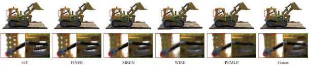

Figure 9. Qualitative comparisons between the FINER and baselines on NeRF.

the details of the shank, WIRE overcomes the limitation of SIREN for representing high-frequency shank at the cost of rough pectoral. For PEMLP, because the pre-defined frequency may not match the frequency distribution in the SDF of Armadillo, both the smooth pectoral and rough shank are not well represented. Gauss could not provide stable representation for all shapes (Tab. 2) and there are obvious artefacts in the reconstructed SDF such as the noise outside the shape in Fig. 8. Compared with these baselines, FINER could provide consistent performance for reconstructing both the low- and high-frequency components.

### 5.3. Neural Radiance Fields Optimization

Novel view synthesis, which aims at rendering realistic images at uncaptured poses from a set of images captured at different positions, is one of the key problems in both communities of computer vision and graphics. Recently, representing scenes as neural radiance fields (NeRF) [23] using INR dominates this task due to the advantages of realism and scalability for embedding different rendering processes [35]. Given a 3D point \(\vec{x}\) and a 2D observed direction \(\vec{d}\), NeRF focuses on learning a 5D mapping function \(f: \mathbb{R}^5 \to \mathbb{R}^4\) with 5D \((\vec{x}, \vec{d})\) to its 3D color \(c\) and 1D opacity \(\sigma\). For any pixel \(p\) in novel view images, its ray function in 3D space is firstly calculated using the in/extrinsic matrices of camera [9], then \(N\) points are sampled along the ray within a predefined depth range, furthermore the direction and position coordinates of these \(N\) points are fed into the INR for querying the radiance value \((c, \sigma)\), finally the color \(C(p)\) of the pixel is calculated using the differentiable volume rendering technique [22, 23],

\[
\begin{array}{l} C (p) = \sum_ {i = 1} ^ {N} T _ {i} \left(1 - \exp \left(- \sigma_ {i} \delta_ {i}\right)\right) c _ {i} \\ T _ {i} = \exp \left(- \sum_ {j = 1} ^ {i - 1} \sigma_ {j} \delta_ {j}\right), \tag {10} \\ \end{array}
\]

where  \( \delta_{i} \)  represents the distance between the neighbors in the sampled N points.

We evaluate the FINER for this task and compare to four classical methods mentioned above. To better verify the advantages of FINER for representing high-frequency compo-

Table 3. Quantitative comparisons on novel view synthesis.

|   | Methods | Chair | Drums | Ficus | Hotdog | Lego | Materials | Mic | Ship  |
| --- | --- | --- | --- | --- | --- | --- | --- | --- | --- |
|  PSNR ↑ | PEMLP | 31.32 | 20.18 | 24.49 | 30.59 | 25.90 | 25.16 | 26.38 | 21.46  |
|   |  Gauss | 32.68 | 23.16 | 26.10 | 32.17 | 28.29 | 26.19 | 33.59 | 22.28  |
|   |  SIREN | 33.31 | 24.89 | 27.26 | 32.85 | 29.60 | 27.13 | 33.28 | 22.25  |
|   |  WIRE | 29.31 | 22.22 | 25.91 | 30.11 | 25.76 | 25.05 | 32.35 | 21.15  |
|   |  FINER | 33.90 | 24.90 | 28.70 | 33.05 | 30.04 | 27.05 | 33.96 | 22.47  |
|  SSIM ↑ | PEMLP | 0.960 | 0.814 | 0.914 | 0.945 | 0.904 | 0.909 | 0.960 | 0.754  |
|   |  Gauss | 0.967 | 0.883 | 0.933 | 0.956 | 0.932 | 0.916 | 0.980 | 0.782  |
|   |  SIREN | 0.971 | 0.912 | 0.947 | 0.960 | 0.948 | 0.932 | 0.979 | 0.788  |
|   |  WIRE | 0.938 | 0.858 | 0.931 | 0.938 | 0.886 | 0.898 | 0.978 | 0.734  |
|   |  FINER | 0.973 | 0.911 | 0.958 | 0.959 | 0.951 | 0.928 | 0.981 | 0.792  |
|  LPIPS ↓ | PEMLP | 0.026 | 0.185 | 0.056 | 0.037 | 0.070 | 0.050 | 0.057 | 0.190  |
|   |  Gauss | 0.019 | 0.082 | 0.055 | 0.032 | 0.040 | 0.037 | 0.013 | 0.136  |
|   |  SIREN | 0.017 | 0.051 | 0.033 | 0.032 | 0.030 | 0.028 | 0.014 | 0.116  |
|   |  WIRE | 0.035 | 0.106 | 0.045 | 0.048 | 0.075 | 0.058 | 0.014 | 0.172  |
|   |  FINER | 0.015 | 0.052 | 0.024 | 0.033 | 0.025 | 0.032 | 0.010 | 0.108  |

nents, we follow the experimental setting of WIRE that only 25 images are used for training instead of commonly used 100 images, additionally the same \(\omega_0\) is set in both FINER and SIREN. Tab. 3 and Fig. 9 provide quantitative and qualitative comparisons of FINER against different methods on the Blender dataset [23]. FINER achieves the best performance in almost all 8 scenes. Fig. 9 demonstrates the advantage of FINER for representing high-frequency components visually. For example, the holes (red boxes) and the highlights (green boxes) in the frame of the truck are over-smoothed in the reconstructions of all baselines, only FINER could provide clear details here.

## 6. Conclusion

We have proposed and verified the FINER which uses variable-periodic functions for activating the INR. We have pointed out that current INRs suffer from a limited supported frequency set due to the under-utilization of the definition domain of activation functions. The proposed FINER overcomes this problem by introducing variable-periodic activation function and initializing the bias vector to different ranges, where different sub-functions with different frequencies along the definition domain will be selected for activation. As a result, the supported frequency set of FINER could be flexibly tuned, and the capacity of INR could be significantly enlarged. We have demonstrated the advantages of FINER over other INRs in image fitting, 3D shape representation and neural rendering.

2720