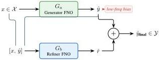

CoDIT 2026 - Technical Co-Sponsors: IEEE CSS, IEEE SMC & IEEE RAS

the GedankenNet [5] self-supervised holographic reconstruction pipeline, replacing the single FNO backbone with a two-stage Generator–Refiner architecture that captures both low- and high-frequency components of the complex wavefield.

2) We introduce a fully self-supervised training paradigm for the boosted architecture, eliminating the need for ground-truth phase images by enforcing physics consistency through the ASM propagator, combined with a multi-component loss function (spectral MAE, spatial MSE, and total variation regularization).
3) We conduct a systematic experimental comparison between PhysSpec-FNO and a supervised Hybrid variant across four domain configurations and real biological specimens, demonstrating 33% higher SSIM in matched-domain settings while uncovering a fundamental specialization–generalization trade-off with practical implications for biomedical imaging system design.

## II. RELATED WORK

### A. Fourier Neural Operators

The FNO, introduced by Li et al. [6], learns mappings between function spaces by parameterizing the integral kernel in the Fourier domain. By performing global convolutions via the Fast Fourier Transform (FFT), FNOs capture long-range dependencies that conventional convolutional architectures miss. This property is particularly advantageous for holographic reconstruction, where the relationship between recorded intensities and the underlying complex field is inherently global in the frequency domain. Subsequent work has extended FNOs to various imaging and PDE-solving tasks [9]. However, Xiao et al. [8] identified a critical limitation: FNOs exhibit a distinct low-frequency bias due to their global Fourier filters and mode truncation, leading to larger errors in high-frequency components of the prediction.

### B. GedankenNet: Self-Supervised Holographic Reconstruction

GedankenNet [5] pioneered self-supervised holographic phase retrieval without any ground-truth images. The framework employs a single FNO as its backbone and derives supervision entirely from the physics of wave propagation: the network's predicted complex field is numerically propagated back to the sensor plane using the ASM, and the resulting simulated hologram is compared against the measured input. Crucially, GedankenNet trains on synthetically generated random images bearing no resemblance to real-world samples, yet generalizes remarkably to experimental holograms of biological specimens. This paradigm eliminates the need for paired ground-truth data, which is costly or impossible to acquire in practice.

### C. SpecBoost: Spectral Boosting for FNOs

To address FNO's low-frequency bias, Xiao et al. [8] proposed SpecBoost, an ensemble learning framework that sequentially trains two FNOs, as illustrated in Fig. 1. The

Fig. 1. SpecBoost architecture [8]. The Generator \( G_{a} \) produces an initial estimate \( \hat{y} \) exhibiting low-frequency bias. The Refiner \( G_{b} \) receives the concatenated input \( [x, \hat{y}] \) and predicts a residual correction \( \hat{r} \). The final prediction \( \hat{y}_{\mathrm{final}} = \hat{y} + \hat{r} \) captures both low- and high-frequency components.

first FNO \((\mathcal{G}_a)\) undergoes standard training and captures low-frequency components effectively. A second FNO \((\mathcal{G}_b)\) is then trained on the prediction residuals \(r = y - \hat{y}\) of the first, using the concatenation of the input and the first FNO's prediction \([x,\hat{y}]\) as input. The final output combines both predictions: \(\hat{y} +\hat{r}\). Originally designed and validated for PDE-solving tasks (Navier-Stokes, Darcy flow), SpecBoost achieved up to \(71\%\) improvement in prediction accuracy. However, it was designed as a supervised framework requiring ground-truth labels—its application to self-supervised settings such as holographic reconstruction has not been explored prior to this work.

## III. PROPOSED METHOD: PHYSSPEC-FNO

The central idea behind PhysSpec-FNO is to combine the spectral boosting strategy of SpecBoost [8] with the self-supervised holographic paradigm of GedankenNet [5]. GedankenNet employs a single FNO2d trained for 2,000 epochs using only a physics-consistency loss. While effective, a single FNO is limited by its inherent low-frequency bias [8], leaving high-frequency phase details underrepresented. PhysSpec-FNO addresses this limitation by replacing the single backbone with a two-stage Generator-Refiner pipeline trained entirely through physics-consistency constraints, recovering high-frequency components without requiring ground-truth data.

This transfer is non-trivial: the original SpecBoost [8] trains  \( G_{b} \)  on the explicit residual  \( r = y - \hat{y} \) , but y is precisely the unknown complex wavefield in our setting, so the residual signal driving its second stage does not exist. Our contribution is therefore the training paradigm rather than the architecture: both  \( G_{a} \)  and  \( G_{b} \)  are supervised through the same ASM-based physics loop, and a two-phase freeze schedule (Section III-D) replaces the explicit residual signal by structurally constraining  \( G_{b} \)  to a correction observable only via the propagated hologram.

Fig. 2 summarizes the architectural and training differences between GedankenNet, PhysSpec-FNO, and the supervised Hybrid SpecBoost baseline.

### A. Fourier Neural Operator Backbone

Each stage uses a customized FNO2d backbone. The spectral convolution layer performs a 2D FFT, multiplies retained

2200

Authorized licensed use limited to: National Research Nuclear University - MEPhi. Downloaded on November 06,2026 at 18:40:50 UTC from IEEE Xplore. Restrictions apply.