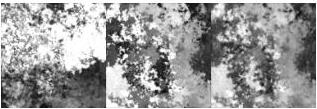
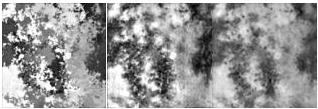
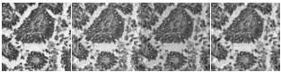
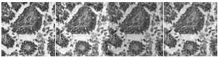

CoDIT 2026 - Technical Co-Sponsors: IEEE CSS, IEEE SMC & IEEE RAS

TABLE I
AVERAGE SSIM ACROSS DOMAIN CONFIGURATIONS

|  Train | Test | PhysSpec-FNO | GedankenNet | Hybrid  |
| --- | --- | --- | --- | --- |
|  Random | Random | 0.8459 | 0.6694 | 0.6360  |
|  Random | COCO | 0.6347 | 0.6064 | 0.6415  |
|  COCO | Random | 0.1940 | 0.6060 | 0.3737  |
|  COCO | COCO | 0.7935 | 0.7547 | 0.6940  |

Ground Truth

PhysSpec (0.764)

Hybrid (0.616)

Ground Truth

PhysSpec (0.871)

Hybrid (0.623)

Fig. 4. Matched-domain reconstructions (train and test on same dataset). Columns: ground-truth phase, PhysSpec-FNO, Hybrid SpecBoost. Top: COCO→COCO. Bottom: Random→Random. SSIM (higher = better) vs. ground truth in parentheses.

### E. Qualitative Results

Figs. 4 and 5 present visual comparisons across all four domain configurations. In matched domains (Fig. 4), PhysSpec-FNO produces sharper reconstructions: on COCO→COCO it achieves SSIM 0.764 vs. 0.616, and on Random→Random 0.871 vs. 0.623. In cross-domain settings (Fig. 5), PhysSpec-FNO retains a slight edge on Random→COCO (0.602 vs. 0.535) but Hybrid SpecBoost is stronger on COCO→Random (0.463 vs. 0.366), confirming its greater cross-domain robustness.

To validate practical applicability, Fig. 6 presents reconstructions of a real lung tissue specimen drawn from the publicly released GedankenNet stained-tissue benchmark [5]. Each sample provides an experimental hologram (inputData) together with a complex-field reference (targetData, real + imaginary channels) obtained by classical multi-height phase recovery from the same hologram captured at many axial planes. We use this MH-PR reference as the ground truth for SSIM computation, evaluating against both the reconstructed amplitude and phase components of \(\hat{y}_{\mathrm{final}}\). Among COCO-trained models, PhysSpec-FNO achieves the highest fidelity (phase SSIM 0.498), followed by Hybrid SpecBoost (0.481) and the original GedankenNet baseline (0.466). For Random-trained models, PhysSpec-FNO again leads (0.481), with GedankenNet (0.469) and Hybrid (0.455) close behind. PhysSpec-FNO is therefore the strongest re

Ground Truth

PhysSpec (0.602)

Hybrid (0.535)

Ground Truth

PhysSpec (0.366)

Hybrid (0.463)

Fig. 5. Cross-domain reconstructions. Layout as in Fig. 4. Top: Random→COCO. Bottom: COCO→Random. The supervised Hybrid baseline degrades less than PhysSpec-FNO under domain shift (see Section V).

MH-PR Ref.

PhysSpec (0.498)

GedankenNet (0.466)

Hybrid (0.481)

MH-PR Ref.

PhysSpec (0.481)

GedankenNet (0.469)

Hybrid (0.455)

Fig. 6. Real lung tissue reconstruction from the GedankenNet stained-tissue benchmark [5]. Columns: multi-height phase recovery (MH-PR) reference, PhysSpec-FNO, GedankenNet, Hybrid; phase SSIM in parentheses. Top: trained on COCO. Bottom: trained on Random. Spectral-boosted variants (PhysSpec, Hybrid) consistently improve on the single-FNO GedankenNet baseline.

construction in both training regimes, and the Refiner stage provides a consistent gain over the single-FNO GedankenNet predecessor on real biological samples—confirming the practical advantage of physics-driven spectral specialization for biological microscopy.

### F. Training Dynamics

Fig. 7 shows the training dynamics. PhysSpec-FNO exhibits two-phase behavior: during Phase 1 (epochs 0–1000),  \( G_{a} \)  reduces the physics loss; at the Phase 2 transition, a brief loss spike occurs as  \( G_{b} \)  begins training, followed by a significant SSIM jump confirming the Refiner's contribution. Hybrid SpecBoost converges more uniformly but plateaus earlier.

## V. DISCUSSION

The results expose a fundamental trade-off between specialization and generalization. PhysSpec-FNO's physics loss

2203

Authorized licensed use limited to: National Research Nuclear University - MEPhi. Downloaded on November 06,2026 at 18:40:50 UTC from IEEE Xplore. Restrictions apply.