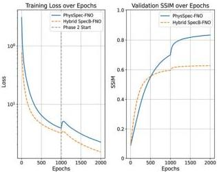

CoDIT 2026 - Technical Co-Sponsors: IEEE CSS, IEEE SMC & IEEE RAS

Fig. 7. Training dynamics. Left: loss (log scale). Right: validation SSIM. The dashed vertical line marks the Phase 2 transition where the Refiner $G_b$ begins training, producing a characteristic loss spike followed by a sharp SSIM improvement.

forces the network to internalize the structural statistics of the training distribution—spatial frequency spectra, correlation lengths, phase distributions—yielding strong matched-domain performance (SSIM 0.846) but sharp degradation under domain shift; Hybrid SpecBoost's supervised MSE loss instead encourages generic input–output mappings, producing more uniform but lower-peak performance.

Role of spectral boosting. Fig. 7 provides direct evidence that $G_b$ captures information complementary to $G_a$: the sharp SSIM jump at the Phase 2 transition ($0.43 \rightarrow 0.846$) shows that nearly half of the final fidelity originates from high-frequency residual correction. This extends the spectral-bias finding of [8] from supervised PDE solvers to the self-supervised holographic setting.

Biological microscopy and deployment. PhysSpec-FNO's specialization is advantageous for biological data: COCO-trained, it reaches SSIM 0.509 on lung tissue vs. 0.484 for the baseline, as cellular structures share spatial-frequency characteristics with natural images. PhysSpec-FNO is therefore recommended for dedicated pipelines with a well-defined sample type and no ground truth; Hybrid SpecBoost is preferable when the imaging pipeline must handle heterogeneous samples. A promising direction is self-supervised pre-training with selective supervised fine-tuning on a small labelled subset.

# VI. CONCLUSION

We presented PhysSpec-FNO, a self-supervised spectral-boosting framework for holographic phase retrieval that combines a two-stage Generator–Refiner FNO with ASM-based

physics-consistency training, eliminating the need for ground-truth complex fields. Across four domain configurations, PhysSpec-FNO substantially outperforms the supervised Hybrid SpecBoost baseline in matched-domain settings (SSIM 0.846 vs. 0.636 for Random→Random; 0.794 vs. 0.694 for COCO→COCO), while the baseline is more robust under domain shift. Experiments on real lung tissue further validate PhysSpec-FNO's practical advantage when trained on structured data (0.509 vs. 0.484). The findings expose a fundamental specialization–generalization trade-off and position PhysSpec-FNO as the method of choice for dedicated biological pipelines with known sample type and no ground truth. Future work: multi-stage boosting ($T > 1$), compute-matched ablations, and validation on dynamic live-cell holograms.

# ACKNOWLEDGMENT

This work was granted access to the HPC resources of IDRIS under the allocations [AD010613582R3] made by GENCI. We also thank the Mesocentre of Franche-Comté for the computing resources. This work was supported by Agence Nationale de la Recherche, HOLO-CONTROL project (Contract No. ANR-21-CE42-0009), by the French Investissements d'Avenir program, SMARTLIGHT project (ANR-21-ESRE-0040) and by Cross-disciplinary Research (EIPHI) Graduate School (contract No. ANR-17-EURE-0002).

# REFERENCES

[1] M. K. Kim, "Principles and techniques of digital holographic microscopy," SPIE Reviews, vol. 1, no. 1, p. 018005, 2010.

[2] Y. Park, C. Depeursinge, and G. Popescu, "Quantitative phase imaging in biomedicine," Nature Photonics, vol. 12, no. 10, pp. 578–589, 2018.

[3] J. R. Fienup, "Phase retrieval algorithms: a comparison," Applied Optics, vol. 21, no. 15, pp. 2758–2769, 1982.

[4] R. W. Gerchberg and W. O. Saxton, "A practical algorithm for the determination of phase from image and diffraction plane pictures," Optik, vol. 35, pp. 237–246, 1972.

[5] L. Huang, H. Chen, T. Liu, and A. Ozcan, "Self-supervised learning of hologram reconstruction using physics consistency," Nature Machine Intelligence, vol. 5, pp. 895–907, 2023.

[6] Z. Li, N. Kovachki, K. Azizzadenesheli, B. Liu, K. Bhatt, A. Stuart, and A. Anandkumar, "Fourier neural operator for parametric partial differential equations," in Proc. Int. Conf. Learning Representations (ICLR), 2021.

[7] S. Cuenat, L. Andréoli, A. N. André, P. Sandoz, G. J. Laurent, R. Couturier, and M. Jacquot, "Fast autofocusing using tiny transformer networks for digital holographic microscopy," Optics Express, vol. 30, no. 14, pp. 24730–24746, 2022. https://doi.org/10.1364/OE.458948

[8] S. Xiao, Z. Li, H. Liu, and A. Anandkumar, "Toward a better understanding of Fourier neural operators: Analysis and improvement from a spectral perspective," arXiv preprint arXiv:2404.07200, 2024.

[9] Z. Li, H. Zheng, N. Kovachki, D. Jin, H. Chen, B. Liu, K. Azizzadenesheli, and A. Anandkumar, "Physics-informed neural operator for learning partial differential equations," ACM/JMS Journal of Data Science, vol. 1, no. 3, pp. 1–27, 2024.

[10] T.-Y. Lin, M. Maire, S. Belongie, J. Hays, P. Perona, D. Ramanan, P. Dollár, and C. L. Zitnick, "Microsoft COCO: Common objects in context," in Proc. European Conf. Computer Vision (ECCV), pp. 740–755, 2014.

[11] Y. Rivenson, Y. Zhang, H. Günaydın, D. Teng, and A. Ozcan, "Phase recovery and holographic image reconstruction using deep learning in neural networks," Light: Science & Applications, vol. 7, p. 17141, 2018.

[12] F. Wang, Y. Bian, H. Wang, M. Lyu, G. Pedrini, W. Osten, G. Barbastathis, and G. Situ, "Phase imaging with an untrained neural network," Light: Science & Applications, vol. 9, no. 1, p. 77, 2020.

[13] G. Barbastathis, A. Ozcan, and G. Situ, "On the use of deep learning for computational imaging," Optica, vol. 6, no. 8, pp. 921–943, 2019.

2204

Authorized licensed use limited to: National Research Nuclear University - MEPhi. Downloaded on November 06,2026 at 18:40:50 UTC from IEEE Xplore. Restrictions apply.