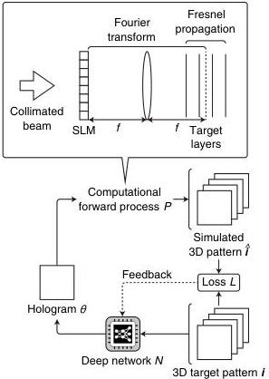

A324

Vol. 60, No. 4 / 1 February 2021 / Applied Optics

Research Article

Fig. 1. Computational scheme of 3D-DGH.

$$\boldsymbol{\theta}_k = \mathcal{N}(\boldsymbol{i}_k, \boldsymbol{p}), \tag{1}$$

where $\boldsymbol{p}$ is a set of learnable parameters constituting the network.

The generated hologram $\boldsymbol{\theta}_k$ is computationally propagated onto each layer in the target space through the Fourier transform $\mathcal{F}$ and Fresnel propagation with the impulse response $\boldsymbol{r}(x, y, z)$ [29]. Assuming a collimated coherent beam, this forward process $\mathcal{P}$ is written as

$$\hat{\boldsymbol{i}}_k(x, y, z) = \mathcal{P}(\boldsymbol{\theta}_k) \tag{2}$$

$$= \mathcal{C}(|\mathcal{F}(\exp(j\mathcal{Z}(\boldsymbol{\theta}_k(x, y)))) \otimes \boldsymbol{r}(x, y, z)|^2), \tag{3}$$

where $\hat{\boldsymbol{i}}_k(x, y, z)$ is the simulated 3D intensity, $\otimes$ is the 2D convolution operator, and $\mathcal{Z}$ and $\mathcal{C}$ are operators for zero-padding to $n_x' \times n_y'$ pixels and clipping the top-left region of $n_x \times n_y$ pixels in the $x, y$ dimensions, respectively. These operators are introduced in the off-axis configuration.

The simulated intensity $\hat{\boldsymbol{i}}_k$ is evaluated with the following loss function $\mathcal{L}$:

$$= \sqrt{\frac{1}{n_k n_x n_y n_z} \left\| c_{k,z} \mathcal{P}(\mathcal{N}(\boldsymbol{i}_k, \boldsymbol{p})) - \boldsymbol{i}_k \right\|_2^2}, \tag{5}$$

where $\|\cdot\|_2$ is the norm. This loss function evaluates the root-mean-square error (RMSE) between the target and simulated intensities. A normalization coefficient $c_{k,z}$ is introduced here, which is written as

$$c_{k,z} = \frac{1}{n_x n_y} \sum_{x=1}^{n_x} \sum_{y=1}^{n_y} \boldsymbol{i}_k(x, y, z), \tag{6}$$

which assumes a perfect diffraction efficiency, where the whole of the light intensity illuminating the hologram area of $n_x \times n_y$ pixels contributes to shaping the target intensity pattern $\boldsymbol{i}_k$.

In this study, the set of learning parameters $\boldsymbol{p}$ is optimized by minimizing the loss function $\mathcal{L}$ with a state-of-the-art stochastic gradient decent algorithm called "Adam" [30]. U-Net was used for the network $\mathcal{N}$ [31]. U-Net and U-Net-like networks have been applied to various biomedical imaging applications and image retrieval from spatially mixed signals [32–36]. The networks consist of multiple encoder subnetworks and decoder subnetworks linked with skip connections. The encoders and decoders employ downsampling by max-pooling and upsampling by up-convolution, respectively. Each layer in the 3D intensity $\boldsymbol{i}_k$ is provided to each channel of U-Net as the input, and its output is the hologram $\boldsymbol{\theta}_k$.

The 3D-DGH method is compared with the 3D-GS method, which is an established algorithm for 3D-CGH [12]. In the 3D-GS method, the following steps are computationally iterated: 1) The optical field on the hologram is propagated onto each target layer; 2) the propagating amplitudes on the target layers are replaced by the 3D target pattern; 3) the resultant fields on each target layer are backpropagated separately onto the hologram plane; 4) the backpropagating fields from each target layer are averaged; 5) the hologram is updated using the phase of the resultant field. Here, the forward process in Step 2 is equivalent to Eqs. (2) and (3) in 3D-DGH.

### 3. EXPERIMENTAL DEMONSTRATION

In the demonstrations, the learning performance of the proposed method for a given data set was verified, where we supposed a class of reproduced patterns that were known and limited, such as laser processing and optical tweezers. Layers of the 3D target patterns were images of handwritten digits randomly selected from the EMNIST database, which is a set of handwritten characters [25,28,37]. Layers were divided into two-by-two subregions, and a single digit was located in a single subregion on each layer. The subregions with the digits were randomly and differently chosen in each target pattern without lateral overlapping between each layer. The pixel count of the hologram and the target areas on each layer was

$$\mathcal{L}(\boldsymbol{p}) = \sqrt{\frac{1}{n_k n_x n_y n_z} \sum_{k=1}^{n_k} \sum_{x=1}^{n_x} \sum_{y=1}^{n_y} \sum_{z=1}^{n_z} \left( c_{k,z} \hat{\boldsymbol{i}}_k(x, y, z) - \boldsymbol{i}_k(x, y, z) \right)^2} \tag{4}$$