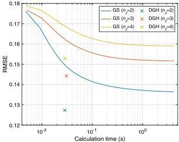

Research Article

Vol. 60, No. 4 / 1 February 2021 / Applied Optics

A325

96 × 96 (= nₓ × nᵧ). This was more than 100 times smaller than the pixel count used in state-of-the-art studies of CGH due to the limitations of our computational resources, which restricted the performances of both 3D-DGH and 3D-GS to compare them under the same conditions [4,12–17]. In this situation, target patterns composed of sparse lines like handwritten digits in the EMNIST database were suitable for demonstrating both 3D-DGH and 3D-GS.

The pixel count of a zero-padded image obtained through the operator Z in Eq. (3) was 384 × 384 (= nₓ' × nᵧ'), which was determined to prevent crosstalk of the zeroth-order light to the target area. The number of target layers was set to 2, 3, and 4 (= n_z). The wavelength of the collimated beam was 532 nm. The pixel pitch along the x and axes was 36 μm. The focal length f of the Fourier transform lens was 80 mm. The interval between the layers was 2 mm, and the first layer was located 3 mm before the Fourier plane.

The numbers of images in 3D patterns of the training and test data sets were 279,600 and 400, respectively, without any overlapping between the data sets. In the training process with the Adam optimizer, the learning rate was 0.0001, the gradient decay factor was 0.9, and the squared gradient decay factor was 0.999. The number of epochs was 10, and the batch size was 50 (= n_k). The encoder depth of U-Net was five. These parameters were experimentally chosen. The training and testing of the network in 3D-DGH were performed on a computer with an Intel Xeon 6134 CPU running at 3.2 GHz, with 192 GB of RAM, and an NVIDIA Tesla V100 GPU with 16 GB of VRAM. The training process of 3D-DGH took about one day; further, 3D-GS was also performed on the same computer using CUDA-based GPU processing with the parallel fast Fourier transform. The code in the experimental demonstrations was implemented by using MATLAB and Python.

The 3D-DGH and 3D-GS methods were numerically analyzed with the above-mentioned conditions, as shown in Fig. 2. This figure shows the relationship between the calculation time of hologram synthesis, excluding the training process, and the loss L in Eqs. (4) and (5) for 100 patterns of the test data set. In the case of the 3D-GS method, the number of iterations was varied from 1 to 1000 with an interval of 1, and the calculation times were measured. Each point and line in Fig. 2 was calculated with the average of 100 trials in both the 3D-DGH and 3D-GS methods.

The plots in Fig. 2 trivially show that a larger number of target layers increased the reproduction error in both the 3D-DGH and 3D-GS methods. In the case of the 3D-GS method, a longer iteration process reduced the error; however, it was time-consuming. On the other hand, the 3D-DGH method achieved faster hologram synthesis with less errors than that of 3D-GS using 1000 iterations. Therefore, the 3D-DGH method alleviated the trade-off between the calculation time and the reproduction error in the 3D-GS method. With the 3D-GS method, the average calculation time for n_z = 2, 3, and 4 was 4.30 s at 1000 iterations. With the 3D-DGH method, the average calculation time was 29.3 ms.

The 3D-DGH and 3D-GS methods were experimentally compared, as shown in Fig. 3. The experimental conditions were the same as those in the above numerical analysis. The hologram was implemented with a transmissive SLM (LC2012

Fig. 2. Relationship between the calculation time and reproduction error.

manufactured by HOLOEYE, pixel count: 1024 × 768, pixel pitch: 36 μm) with the phase mode; it was illuminated with a collimated beam from a laser light source (DJ532-40 manufactured by Thorlabs, wavelength: 532 nm), as shown in the upper part in Fig. 1. The transmitting field on the SLM was Fourier-transformed by a lens (focal length f: 80 mm), and the resultant field propagated onto each target layer. The propagating fields on each layer were captured by a monochrome camera (DMK33UX273 manufactured by The Imaging Source, pixel count: 1440 × 1080, pixel pitch: 3.45 μm) with an exposure time of 25 μs. In the case of the 3D-GS method, the numbers of iterations for n_z = 2, 3, and 4 were set to 1000.

A 3D target pattern for four layers (n_z = 4) from the test data set is shown in Fig. 3(a). The first two and three layers also corresponded to the target patterns for two and three layers, respectively. A hologram for two layers (n_z = 2) with the 3D-GS method and its reproduction result is shown in Figs. 3(b) and 3(c), and those with the 3D-DGH method are shown in Figs. 3(d) and 3(e), respectively. A hologram for three layers (n_z = 3) with the 3D-GS method and its reproduction result is shown in Figs. 3(f) and 3(g), and those with the 3D-DGH method are shown in Figs. 3(h) and 3(i), respectively. Similarly, a hologram for four layers (n_z = 4) with the 3D-GS method and its reproduction result is shown in Figs. 3(j) and 3(k), and those with the 3D-DGH method are shown in Figs. 3(l) and 3(m), respectively. The intensities of reproduced patterns with the 3D-DGH method were higher than those with the 3D-GS method, although the latter's reproduced patterns might be sharper. A large number of layers caused artifacts due to interference from other layers in both methods. The reproduced image quality in both the 3D-DGH and 3D-GS methods might be improved by increasing the pixel count of the holograms, which is limited by the current computational resources.

The generalization performance of 3D-DGH with training digits in the previous demonstrations of Figs. 2 and 3 was verified with a test data set composed of uppercase and lowercase alphabetical letters randomly selected from the EMNIST database, as shown in Fig. 4(a), where n_z = 2. In the numerical analysis of this case, the average RMSE with 100 patterns was