A326

Vol. 60, No. 4 / 1 February 2021 / Applied Optics

Research Article

(a)

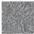

(b)

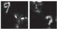

(c)

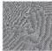

(d)

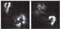

(e)

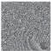

(f)

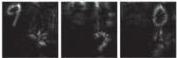

(g)

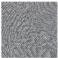

(h)

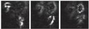

(i)

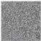

(j)

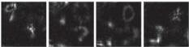

(k)

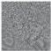

(l)

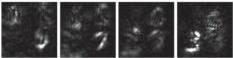

(m)

Fig. 3. Experimental results with different numbers of layers. (a) Target pattern for four layers. (b) Hologram with 3D-GS for two layers and (c) its reproduction result. (d) Hologram with 3D-DGH for two layers and (e) its reproduction result. (f) Hologram with 3D-GS for three layers and (g) its reproduction result. (h) Hologram with 3D-DGH for three layers and (i) its reproduction result. (j) Hologram with 3D-GS for four layers and (k) its reproduction result. (l) Hologram with 3D-DGH for four layers and (m) its reproduction result.

0.136, which was 7% worse than that of the previous simulation in Fig. 2. The hologram with 3D-DGH and its experimental result are shown in Figs. 4(b) and 4(c), respectively. The visual impact due to alphabetic characters, which were not trained, was not very strong in this case by comparison between Figs. 3(e) and 4(c).

The sensitivity against geometries of 3D-DGH with training patterns without lateral overlapping in the previous demonstrations of Figs. 2 and 3 was also evaluated with a test data set composed of patterns with lateral overlapping, as shown in Fig. 5(a), where $n_z = 2$. In the numerical analysis of this case,

(a)

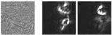

(b)

(c)

Fig. 4. Experimental results by training digits and testing alphabetical letters. (a) Target pattern for two layers. (b) Hologram with 3D-DGH and (c) its reproduction result.

(a)

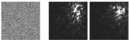

(b)

(c)

Fig. 5. Experimental results by training without lateral overlapping and testing with lateral overlapping. (a) Target pattern for two layers. (b) Hologram with 3D-DGH and (c) its reproduction result.

the average RMSE with 100 patterns was 0.153, which was 20% worse than that of the previous simulation in Fig. 2. The hologram with 3D-DGH and its experimental result are shown in Figs. 5(b) and 5(c), respectively. This degradation due to lateral overlapping might be caused by strong interference from other layers and the high sensitivity of 3D-DGH against untrained geometries.

Although the network adapted or overfitted the given training class, as shown by the results in the previous two paragraphs, optical patterns formed by CGH can be assumed in several applications, such as in laser processing and optical tweezers. This limited generalization performance might be improved by investigating the network architecture and increasing the computational power.

## 4. CONCLUSION

In summary, we proposed and demonstrated 3D-DGH, in which a hologram is noniteratively and directly calculated with a deep convolutional neural network to optically reproduce a 3D target pattern in a given class. The network was trained with a loss between the target pattern and multislice propagation from the hologram synthesized by the network. The 3D-DGH method was numerically and experimentally compared with the 3D-GS method. In the demonstrations, the EMNIST database was used for the training and test data sets. U-Net was employed for the network architecture of 3D-DGH as a first trial, although U-Net was not optimized for this application.