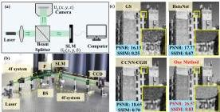

2025 IEEE International Conference on Multimedia and Expo (ICME) | 979-8-3315-9495-4/25/$31.00 ©2025 IEEE | DOI: 10.1109/ICME59968.2025.11210165

# Unfolding Framework with Complex-Valued Deformable Attention for High-Quality Computer-Generated Hologram Generation

Haomiao Zhang \( ^{1,2} \)  Zhangyuan Li \( ^{1,2} \)  Yanling Piao \( ^{3} \)  Zhi Li \( ^{4,5} \) 
Xiaodong Wang \( ^{1,2} \)  Miao Cao \( ^{1,2} \)  Xiongfei Su \( ^{1,2} \)  Qiang Song \( ^{4} \)  Xin Yuan \( ^{2*} \) 

 \( ^{1} \) Zhejiang University, Hangzhou, Zhejiang 310027, China.

\( ^{2} \) School of Engineering, Westlake University, Hangzhou, Zhejiang 310030, China.

\( ^{3} \) Westlake Institute for Optoelectronics, Hangzhou, Zhejiang 311421, China.

\( ^{4} \) Greater Bay Area Institute for Innovation, Hunan University, Guangzhou 511300, China.

\( ^{5} \) School of Physics, Sun Yat-sen University, Guangzhou 510275, China.

xyuan@westlake.edu.cn

Abstract—Computer-generated holography (CGH) has gained wide attention with deep learning-based algorithms. However, due to its nonlinear and ill-posed nature, challenges remain in achieving accurate and stable reconstruction. Specifically, (i) the widely used end-to-end networks treat the reconstruction model as a black box, ignoring underlying physical relationships, which reduces interpretability and flexibility. (ii) CNN-based CGH algorithms have limited receptive fields, hindering their ability to capture long-range dependencies and global context. (iii) Angular spectrum method (ASM)-based models are constrained to finite near-fields. In this paper, we propose a Deep Unfolding Network (DUN) that decomposes gradient descent into two modules: an adaptive bandwidth-preserving model (ABPM) and a phase-domain complex-valued denoiser (PCD), providing more flexibility. ABPM allows for wider working distances compared to ASM-based methods. At the same time, PCD leverages its complex-valued deformable self-attention module to capture global features and enhance performance, achieving a PSNR over 35 dB. Experiments on simulated and real data show state-of-the-art results. Code is available at https://github.com/HannahZhang1926/Complex-Valued-Deformable-Transformer-for-CGH.

Index Terms—Computer-generated holography, Convolutional neural network, Transformer, Deep unfolding network

## I. INTRODUCTION

Computer-generated holography (CGH) is a prominent display technology, which has attracted wide interest. Traditional CGH algorithms [1]–[3] suffer from poor performance and long reconstruction time. Deep learning methods, especially end-to-end (E2E) networks, often surpass traditional model-based approaches in both efficiency and effectiveness, significantly enhancing CGH quality while reducing computational complexity [4], [5]. However, E2E algorithms lack flexibility. For example, if the wavelength or propagation distance (optical parameters) change, a new network has to be trained. In contrast, deep unfolding networks (DUNs) offer strong interpretability and flexibility, while achieving strong performance in vision tasks [6]. Additionally, CNN-based algorithms have limited receptive fields, losing detailed information due to

Fig. 1. (a) Schematic of CGH model. (b) Experiment setup of our CGH system (BS: beam splitter, CCD: charge-coupled device, P: polarizer). (c) Comparison between the reconstruction results of several representative CGH algorithms in 256×256 resolution.

challenges in capturing long-range relationships. In contrast, Transformer models excel at capturing long-range, non-local relationships, improving reconstruction quality by preserving more global and detailed information [7], [8].

Meanwhile, in diffractive optics, angular spectrum method (ASM)-based algorithms are limited by the transfer function [9] and require equal-sized object and image planes. Previous research [10] showed that applying ASM beyond its working distances leads to significant image distortion, such as spectrum aliasing. Efforts have been made to ensure accurate propagation across varying distances, including band-limited angular spectrum method [10], non-uniform sampling [11], adaptive sampling [12], etc.

In summary, the motivations behind our proposed methods are: (i) E2E-CNN algorithms suffer from a lack of flexibility and interpretability and are limited by the respective field [4], [5]. (ii) Global attentional mechanisms in existing Complex-valued Transformers have higher memory consumption, making them inefficient for CGH reconstruction [13]–[15]. (iii) ASM model has a limited propagation distance [9]. Bearing these concerns in mind, we propose a novel approach for high-quality CGH generation. Our main contributions are summarized as follows.

- We propose a DUN framework incorporating global im-

Authorized licensed use limited to: National Research Nuclear University - MEPhi. Downloaded on November 06,2026 at 18:16:46 UTC from IEEE Xplore. Restrictions apply.