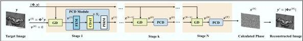

Fig. 2. The overall framework of our method, containing a deep-unfolding structure with N stages; GD and PCD blocks represent the operation in Eq.(4) and Eq.(5) respectively.

age features and physical constraints in CGH reconstruction, which consists of a gradient descent (GD) module and a deep denoising module to enhance both flexibility and interpretability.

- In the GD module, we replace the widely-used ASM model with an adaptive bandwidth-preserving method (ABPM) based on the sampling theory, enabling a wider working distance.
- In the denoising module, we introduce a Phase-domain Complex-valued Denoiser (PCD) with a Complex-valued Deformable Self-Attention (CDSA) mechanism, leveraging spatial self-attention to achieve more efficient and high-quality reconstruction.
- We built a holographic display system using a phase-only spatial light modulator (SLM) to demonstrate the wide working distance and high performance of our method.

## II. RELATED WORK

Model-based Algorithms for CGH: Model-based CGH algorithms can be broadly classified into iterative and non-iterative methods. Iterative techniques include the Gerchberg-Saxton (GS) method [1], Wirtinger holography [3], and gradient descent [2]. Non-iterative approaches contain point-based [16], double phase-amplitude coding [17] methods et al. Although these techniques are robust and training-free, their limited performance hinders their application in high-quality holographic displays.

Deep Learning Algorithms for CGH: Deep learning-based methods for CGH can be categorized into data-driven and physics-driven models. Data-driven CGHs rely on labeled data to learn the mapping between input scenes and output holograms, but they do not fully incorporate the physical model, limiting their performance [18]–[21]. In contrast, model-based E2E-CNN algorithms [4], [5], [22]–[25] integrate physical diffraction directly into the network, achieving high-fidelity large-scale reconstruction but lacking flexibility and struggling with long-term dependencies, leading to reconstructions below 35 dB. Furthermore, the existing Transformer [26] for CGH reconstruction remains under-explored and suboptimal. In contrast, physics-driven DUNs offer strong performance, clear interpretability, and outperform E2E algorithms in many tasks. [27], [28].

### III. PROBLEM STATEMENT

As depicted in Fig. 1(a), the SLM displays a phase-only hologram \( U_0(x_0, y_0, 0) = \exp(\mathrm{i}\phi(x_0, y_0, 0)) \). After propagating a distance \( z \), the complex amplitude \( U_z(x_z, y_z, z) \) is recorded on the camera plane, containing the information from

\(U_{0}\). This free propagation process can be represented in the matrix form: \(U_{z}(x_{z},y_{z},z)=\mathbf{A}U_{0}(x_{0},y_{0},0)\), where matrix \(\mathbf{A}\) models the discrete propagation from the SLM plane \(z=0\) to the camera plane \(z=d\). Due to CMOS camera limitations, only the intensity information can be captured. Specifically, the captured digital images are closer to the amplitude \(|U_{z}(x_{z},y_{z},z)|\) than to the squared intensity \(|U_{z}(x_{z},y_{z},z)|^{2}\), as noted in [23], [29]. Suppose \(\boldsymbol{y}=U_{z}(x_{z},y_{z},z)\) and \(\boldsymbol{x}=U_{z}(x_{z},y_{z},z)\), and the forward model is formulated as \(\boldsymbol{y}=|\boldsymbol{\Phi}\boldsymbol{x}|\), where \(\boldsymbol{x}\in\mathbb{C}^{W\times H}\), \(\boldsymbol{y}\in\mathbb{R}^{W\times H}\). \(\boldsymbol{\Phi}\in\mathbb{C}^{W\times H}\) denotes the propagation matrix, which corresponds to the ABPM model introduced in our article.

## IV. PROPOSED METHOD

### A. Overall Deep Unfolding Structure

The general structure of our DUN framework is shown in Fig.2. To solve the aforementioned ill-posed equation, a regularizer is introduced to constrain the solution space. This regularization term \( R(\pmb{x}) \) is used to find an estimate \( \hat{\pmb{x}} \) of \( \pmb{x} \) by solving the following problem:

\[
\hat {\boldsymbol {x}} = \arg \min _ {\boldsymbol {x}} \frac {1}{2} \| \boldsymbol {y} - | \boldsymbol {\Phi} \boldsymbol {x} | \| _ {2} ^ {2} + \lambda R (\boldsymbol {x}), \tag {1}
\]

\(\lambda\) balances the fidelity term \(\frac{1}{2}\| \pmb {y} - |\Phi \pmb {x}||_2^2\) and the regularization term. Since the regularization term may be not differentiable or even unknown, it is hard to find a closed-form solution directly. Alternatively, the Half Quadratic Splitting (HQS) method is adopted, which introduces an auxiliary variable \(\pmb {v}\in \mathbb{C}^{W\times H}\) and turns the unconstrained optimization into an augmented Lagrangian function:

\[
(\hat {\boldsymbol {x}}, \hat {\boldsymbol {v}}) = \underset {\boldsymbol {x}, \boldsymbol {v}} {\arg \min} \frac {1}{2} \| \boldsymbol {y} - | \boldsymbol {\Phi} \boldsymbol {v} | \| _ {2} ^ {2} + \lambda R (\boldsymbol {x}) + \frac {\eta}{2} \| \boldsymbol {v} - \boldsymbol {x} \| _ {2} ^ {2}. \tag {2}
\]

Previous research [30] indicated that optimization-based algorithms include : i) Gradient descent and ii) Projection to the signal domain. The first step refines the current estimate by incorporating additional information from the input. The second step constrains the result to the target signal space, typically using a denoiser. Thus Eq.(2) can be solved by decoupling x and v into two iterative sub-problems: woy

\[
\boldsymbol {v} ^ {(k + 1)} = \underset {\boldsymbol {v}} {\arg \min} \left\| \boldsymbol {y} - | \boldsymbol {\Phi} \boldsymbol {v} | \right\| _ {2} ^ {2} + \eta \left\| \boldsymbol {v} - \boldsymbol {x} ^ {(k)} \right\| _ {2} ^ {2}, \tag {3a}
\]

\[
\boldsymbol {x} ^ {(k + 1)} = \underset {\boldsymbol {x}} {\arg \min} \frac {1}{2} \| \boldsymbol {x} - \boldsymbol {v} ^ {(k + 1)} \| _ {2} ^ {2} + \lambda R (\boldsymbol {x}). \tag {3b}
\]

For the \(v\)-subproblem, Eq. (3a) has a closed-form solution [29]:

\[
\begin{array}{l} \boldsymbol {v} ^ {(k + 1)} = \boldsymbol {x} ^ {(k)} - \rho \nabla_ {\boldsymbol {x}} F (\boldsymbol {x} ^ {(k)}), \\ = \boldsymbol {x} ^ {(k)} - \boldsymbol {\Phi} ^ {H} \operatorname{diag} \left(\frac {\boldsymbol {\Phi} \boldsymbol {x} ^ {(k)}}{| \boldsymbol {\Phi} \boldsymbol {x} ^ {(k)} |}\right) (\boldsymbol {y} - | \boldsymbol {\Phi} \boldsymbol {x} ^ {(k)} |), \tag {4} \\ \end{array}
\]

Authorized licensed use limited to: National Research Nuclear University - MEPhi. Downloaded on November 06,2026 at 18:16:46 UTC from IEEE Xplore. Restrictions apply.