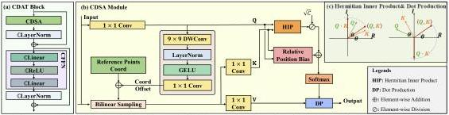

Fig. 3. (a) The diagram of CDAT block. (b) Complex-valued Deformable Self-Attention (CDSA) module. (c) An illustration of the difference between Hermitian inner production and dot production.

where $\nabla_{\boldsymbol{x}}F(\boldsymbol{x}^{(k)})$ denotes the gradient of $F(\boldsymbol{x}) = |\Phi \boldsymbol{x}|$ at the point $\boldsymbol{x} = \boldsymbol{x}^{(k)}$. $\nabla_{\boldsymbol{x}}F(\boldsymbol{x}^{(k)})$ is derived as $\nabla_{\boldsymbol{x}}F(\boldsymbol{x}) = \frac{1}{2}\Phi^{H}\mathrm{diag}\left(\frac{\Phi\boldsymbol{x}}{|\Phi\boldsymbol{x}|}\right)(\boldsymbol{y} - |\Phi\boldsymbol{x}|)$, where $(\cdot)^H$ denotes the conjugate transpose operator. Notice that $\frac{1}{2}$ is absorbed into the constant $\rho$, and $\rho$ is set to 1.

For the $\boldsymbol{x}$-subproblem, Eq. (3b) aims to find $\boldsymbol{x}^{(k+1)}$ that is as close as possible to the updated $\boldsymbol{v}^{(k+1)}$ while maintaining consistency with previous iteration. Since modeling a proper prior for complex amplitude fields is nontrivial, we implement the mapping from $\boldsymbol{v}^{(k+1)}$ to $\boldsymbol{x}^{(k+1)}$ using a deep neural network. This module is referred to as the Phase-domain Complex-valued Denoiser (PCD):

$$\boldsymbol{x}^{(k+1)} = \mathrm{PCD}(\boldsymbol{v}^{(k+1)}). \tag{5}$$

Eq. (4) and Eq. (5) form one iteration (or stage) to solve Eq.(1). In our DUN framework, this iteration is applied a few times, allowing explicit unfolding and independent network parameters for PCDs at each stage. Learnable PCDs, derived from real data, are more efficient and accurate than traditional hand-crafted priors. By combining the optimization algorithm with the denoising network, our method is both effective and interpretable. Next, we provide a detailed explanation of the propagation matrix $\Phi$ and PCD blocks.

### B. Adaptive Bandwidth-Preserving Method

To ensure diffraction calculations are performed accurately at all working distances, we rewrite the ASM propagation model as follows:

$$U_z(x_z, y_z, z) = \begin{cases} \mathcal{F}^{-1}\left\{H(f_x, f_y, z)\mathcal{F}\left\{U_0(x_0, y_0, 0)\right\}\right\}, & z \le z_1. \\ \mathcal{F}^{-1}\left\{\mathcal{F}\left\{h(x_z, y_z, z)\right\}\mathcal{F}\left\{U_0(x_0, y_0, 0)\right\}\right\}, & z_1 < z \le z_2. \\ \mathcal{F}^{-1}\left\{\mathcal{F}\left\{h'(x_z, y_z, z)\right\}\mathcal{F}\left\{U_0(x_0, y_0, 0)\right\}\right\}, & z > z_2. \end{cases} \tag{6}$$

where $z_1 = N\delta x / \lambda \sqrt{(\delta x)^2 - (\lambda/2)^2}$ is the ASM threshold, $z_2 = (25N^4(\delta x)^4/\lambda)^{\frac{1}{3}}$ is the far field threshold, and $h(x_z, y_z, z)$ and $h'(x_z, y_z, z)$ are the impulse response at various propagation distance. We name this propagation model the adaptive bandwidth-preserving method (ABPM). In far-field propagation, common models such as Fresnel or Fraunhofer increase the image plane size, requiring target image prescaling, which reduces fidelity. The band-limited ASM extends propagation slightly further but may lose high-frequency information. The two-step Fresnel model, suitable only for

long distances, may lack accuracy. Our ABPM model ensures rigorous sampling across general cases, with the image plane's pixel size matching that of the SLM, avoiding scaling issues. Details are provided in the Supplementary Material (SM).

### C. Phase-domain Complex-valued Denoiser

As shown in Fig. 2, the PCD module consists of three parts: i) Feature Extraction Module (FEM), ii) Complex-valued Deformable Attention Transformer (CDAT) blocks and iii) Phase Image Recovery Module (PIRM). The FEM and PIRM are explained in detail in the SM.

In Fig. 3(a), the CDAT module consists of a Complex-valued Deformable Self-Attention (CDSA) module and a Complex-valued Feed-Forward Network (CFFN), both using complex-valued layer normalization for stable training and residual shortcuts for improved efficiency. The CDSA module will be discussed next. The CFFN enhances CDAT's non-linearity and representation ability, featuring two complex-valued linear layers (please refer to the SM) with ReLU activation applied separately to the real and imaginary parts of the input.

### D. Complex-valued Deformable Self-Attention module

Previous works [14], [15] adopt the global scaled dot-product self-attention mechanism, which suffers from high time complexity, making it impractical for large-scale high-resolution CGH generation. The computational bottleneck occurs mainly at the softmax function, thus reducing the input size of the softmax function, i.e. the size of the attention matrix $\boldsymbol{Q}\boldsymbol{K}^T$, is crucial. In contrast, we employ a local, deformable self-attention mechanism [31] that adaptively selects the attention regions, which alleviates the computational burden concerning image size.

The structure of our proposed CDSA module is shown in Fig. 3(b). The CDSA module receives the feature map $\boldsymbol{f} \in \mathbb{C}^{H/4 \times W/4 \times C}$ from FEM (the FEM will down-sample the size of the input feature map to a quarter). For simplicity, we denote $\tilde{H} = H/4$ and $\tilde{W} = W/4$. To shrink the size of the attention matrix, the deformable attention mechanism chooses to down-sample $\boldsymbol{f}$ before calculating $\boldsymbol{K}$ and $\boldsymbol{V}$. The down-sampled points' coordinates are the sum of a fixed reference point and a Query-dependent offset. The reference points are evenly distributed across the original feature map, and their density determines the down-sample rate. In our case, the rate is 64 (8 on each side), reducing the attention matrix by a factor

Authorized licensed use limited to: National Research Nuclear University - MEPhi. Downloaded on November 06,2026 at 18:16:46 UTC from IEEE Xplore. Restrictions apply.