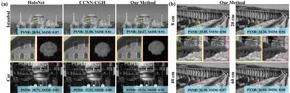

Fig. 4. Simulation:(a) Numerical reconstructions of CGH generated by different algorithms on four benchmark datasets at 1920×1080 resolution. (b) CGH reconstruction results of our algorithm at 8 cm, 20 cm, 40 cm, and 60 cm. Zoom in for a better view.

of 64. The offset is generated from Q. As shown in Fig. 3(b), a 1 × 1 convolution layer converts f into the Q ∈ ℂᴺᴼˣᶜ (N_Q = H̄W), and then a sub-network transforms the Q into coordinate offsets. To be specific, the sub-network consists of a depth-wise convolution layer, a layer normalization, a GELU activation function, and a 1 × 1 regular convolution layer. The kernel size, stride, and padding size of depth-wise convolution are set to 9 × 9, 8, and 4, which is consistent with the down-sample rate setting. After the last 1 × 1 convolution, the channel dimension of the feature map is reduced to 2, meaning offset value on the x and y axes respectively. Note that the bias in the 1 × 1 convolution is omitted to prevent uniform shifts across locations. With the coordinates of the reference points and their offsets, a down-sampled feature map can be interpolated from the original input f. After this, two 1 × 1 convolution layers convert this feature map into the K ∈ ℂᴺᴷˣᶜ and V ∈ ℂᴺᴼˣᶜ (N_K = N_V = H̄W/64) separately.

When calculating the similarity between Q and K, the dot product operation QKᵀ fails to capture the phase similarity of the complex-valued query-key pairs. To address this, we use the Hermitian inner product to measure their similarity. Given two complex vectors x, y ∈ ℂⁿ, the Hermitian inner product is defined as ⟨x, y⟩ = ∑ⱼ₌₁ⁿ xⱼȳⱼ = ∑ⱼ₌₁ⁿ |xⱼ||yⱼ|exp[i(φₓⱼ - φᵧⱼ)], while the dot product is xyᵀ = ∑ⱼ₌₁ⁿ xⱼyⱼ = ∑ⱼ₌₁ⁿ |xⱼ||yⱼ|exp[i(φₓⱼ + φᵧⱼ)]. Although the amplitudes of ⟨x, y⟩ and xyᵀ are identical, the phase angle of ⟨x, y⟩ can reflect the phase discrepancy between x and y, while xyᵀ cannot. This proves the rotation invariance of the Hermitian inner product. As depicted in Fig. 3(c), given two complex inputs x and y with fixed phase angle discrepancy, the results of the dot product will change when we rotate x and y synchronously while the results of Hermitian inner product remain the same.

The Hermitian inner product similarity ⟨Q, K⟩ ∈ ℂᴺᴼˣᴺᴷ is scaled by √C and combined with a relative position bias matrix to form a complex attention matrix. During softmax normalization, only the real part is used. Since the similarity dominates the attention matrix (due to initially small values in T), the real part of Hermitian inner product similarity, i.e., ∑ⱼ₌₁ⁿ |xⱼ||yⱼ|cos(φₓⱼ - φᵧⱼ), maximizes when cos(φₓⱼ - φᵧⱼ) = 1, equaling to φₓⱼ = φᵧⱼ. It strictly decreases while

|φₓⱼ - φᵧⱼ| grows from 0 to π and minimizes at φₓⱼ = -φᵧⱼ. Thus the real part of the complex attention matrix effectively captures the correlation between Q and K.

The overall CDSA mechanism can be written as:

$$\mathrm{CDSA}(\boldsymbol{f}) = \sigma \left( \mathcal{R} \left( \frac{\langle \boldsymbol{W}_Q \boldsymbol{f}, \boldsymbol{W}_K \phi(\boldsymbol{f}) \rangle}{\sqrt{C}} + \boldsymbol{B} \right) \right) \boldsymbol{W}_V \phi(\boldsymbol{f}), \tag{7}$$

where W_Q, W_K, and W_V refer to the 1 × 1 convolution layers and φ(·) is the deformable down-sample function, σ(·) denotes the softmax function, R refers to extracting the real part. In conclusion, the per-layer complexity of the CDSA mechanism is O(N_Q N_K C + N_Q N_V C), which is much lower than the complexity O(2N_Q² C) of scaled dot production self-attention since N_K, N_V ≪ N_Q in our setting.

## V. EXPERIMENTAL RESULTS

### A. Implementation Details

Our model is trained on the DIV2K super-resolution dataset [32], which contains 800 images, and evaluated on 100 randomly selected images from the DIV2K and Flickr2K [33] datasets. Adam optimizer is used with a learning rate of 1e-4. The model is implemented in PyTorch 2.0 and Python 3.9, trained for 30 epochs on an NVIDIA RTX 8000 GPU. Optical parameters are set to a pixel pitch of 8 μm, wavelength of 520 nm, and a maximum resolution of 1920×1080.

### B. Simulation Results

Our method is superior to previous CGH methods in terms of both performance and interpretability by integrating a physics-based DUN structure and achieves a better balance of accuracy and flexibility. To verify the performance of our model, we compare our method with the traditional GS algorithm [1], HoloNet [23] based on CNN with real values, and CCNN-CGH [25] based on CNN with complex values. All models are trained under identical conditions, including the same database, epoch number, and optical setup. The main focus of the comparison is to assess the quality of real-valued images generated from the recovered phase distribution. Peak-Signal-to-Noise-Ratio (PSNR) and Structured Similarity Index Metrics (SSIM) [34] are used to evaluate the results.

Authorized licensed use limited to: National Research Nuclear University - MEPhi. Downloaded on November 06,2026 at 18:16:46 UTC from IEEE Xplore. Restrictions apply.