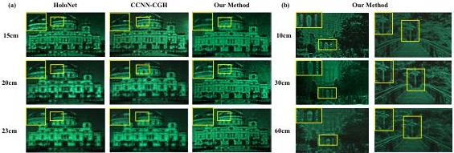

Fig. 5. Real data results: Reconstructed results of various algorithms at different propagation distances with ASM threshold. (b) Reconstructed results of our algorithm beyond the ASM threshold. Zoom in for a better view.

We compare the performance of various algorithms in the near field. According to Eq. (6), the threshold of ASM is 23.62 cm. Therefore, we set the diffraction distance at 20 cm. Tab. I shows a comparison of models trained with various methods at a resolution of  \( 1920 \times 1080 \) . The average PSNR and SSIM values were calculated from 100 validation samples using numerical reconstruction. Our method outperforms others, achieving a PSNR improvement of 4.44-15.19 dB and an SSIM increase of 0.03 to 0.4. Moreover, it requires fewer parameters and lower computational complexity (FLOPs), demonstrating superior performance in CGH tasks. Fig. 4(a) shows the simulated results of two chosen benchmark images from the test data set (Istanbul and Car). The results of the GS algorithm are excluded due to its unsatisfactory performance. Our method produces reconstruction results closer to the ground truth, recovering more detail and exhibiting less noise compared with previous algorithms.

TABLE I PERFORMANCE AT 1920×1080 RESOLUTION CGH GENERATION.

|  Method | Params | FLOPs(G) | Time(ms) | Avg.PSNR | Avg.SSIM  |
| --- | --- | --- | --- | --- | --- |
|  GS | - | - | 10640 | 21.26 | 0.55  |
|  HoloNet | 2,868,754 | 328.53 | 60 | 29.69 | 0.90  |
|  CCNN-CGH | 42,260 | 7.21 | 16 | 32.01 | 0.92  |
|  Our Method | 19,430 | 2.63 | 140 | 36.45 | 0.95  |

We also performed a comprehensive evaluation of our proposed ABPM method at different propagation distances from 8 to 60 cm in Fig.4(b). The results demonstrate the high quality of reconstruction attributed to the inherent effectiveness of the ABPM model, both in the near- and far-fields.

### C. Real Data Results

Our optical system is illustrated in Fig. 1 (b) and more details can be found in SM. The first experiment is designed to test the reconstructed quality under the ASM threshold, with a specific propagation distance of 15 to 23 cm. Due to the poor performance of the GS algorithm, its results are omitted. Real data results are shown in Fig. 5(a), HoloNet produces blurry edges, while CCNN-CGH over-smooths some areas. In contrast, our method yields sharper edges, finer details, and higher resolution, closely matching the actual values,

demonstrating superior reconstruction performance. Fig. 5(b) further validates our algorithm's performance across distances from \(10\mathrm{cm}\) to \(60~\mathrm{cm}\) for two scenes, showing its effectiveness in both near- and far-fields.

## VI. ABLATION STUDY

### A. The Denoising Block

TABLE II ABLATION STUDY ON THE DENOISER BLOCK.

|  Denoiser Type | Resolution | Params | FLOPs(G) | Avg.PSNR(dB) | Avg.SSIM  |
| --- | --- | --- | --- | --- | --- |
|  w/o | 1920×1080 | - | - | 28.56 | 0.79  |
|  Complex TV | 1920×1080 | - | - | 29.54 | 0.85  |
|  Complex CNN | 1920×1080 | 22,368 | 4.46 | 32.12 | 0.90  |
|  CVTF | 256×256 | 114,150 | 1.12 | 29.09 | 0.88  |
|  CDAT | 1920×1080 | 19,430 | 2.63 | 36.45 | 0.95  |

To validate the effectiveness of our algorithms, we conduct an ablation study on the denoising module, comparing our method with direct removal, model-based complex total variation (TV) algorithm  \( [29] \) , learning-based complex CNN algorithm and the existing Complex-Valued Transformer (denoted as CVTF)  \( [15] \) . Due to high computational cost, the resolution in the CVTF comparison is limited to  \( 256 \times 256 \) . As shown in Tab. II, our algorithm achieves an average PSNR improvement of 4.33-7.89 dB and SSIM enhancement of 0.05-0.16, outperforming other methods and demonstrating that the CDAT in our denoising module enables high-quality reconstruction results.

TABLE III ABLATION STUDY ON THE EMBEDDING CHANNELS.

|  Embedding Channels | Params(M) | Flops(G) | Avg.PSNR(dB)  |
| --- | --- | --- | --- |
|  96 | 87,473 | 26.8 | 36.87  |
|  32 | 19,430 | 2.6 | 36.45  |

### B. Embedding Channel

In CGH applications, maintaining a lightweight design is essential. As discussed in Sec. IV-D, the number of embedding channels C is closely related to the computational complexity. As shown in Tab. III, when the embedding dimension is set to 32, the reconstruction achieves excellent results while keeping the computational cost relatively low.

Authorized licensed use limited to: National Research Nuclear University - MEPhi. Downloaded on November 06,2026 at 18:16:46 UTC from IEEE Xplore. Restrictions apply.