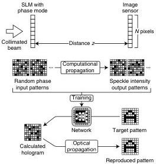
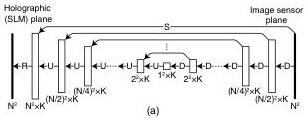
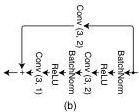
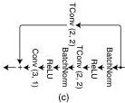
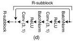
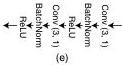

3860

Vol. 57, No. 14 / 10 May 2019 / Applied Optics

Research Article

Fig. 1. Diagram illustrating the proposed method.

and has shown promising results [24]. The network architecture we use is shown in Fig. 2(a). The inverse process $\mathcal{F}^{-1}[\bullet]$ of Eq. (1) is written as

$$\hat{\mathbf{x}} = \mathcal{F}^{-1}[\hat{\mathbf{y}}]. \tag{3}$$

The output of this inverse process and the network in Fig. 2(a) is a phase pattern $\hat{\mathbf{x}} \in \mathbb{R}^{N^2 \times 1}$ displayed on the SLM, to reproduce a target intensity pattern $\hat{\mathbf{y}} \in \mathbb{R}^{N^2 \times 1}$ on the image sensor, as shown in Fig. 1.

Fig. 2. Structures of the (a) whole network, (b) D-block, (c) U-block, (d) R-block, and (e) S-block.

In the training process, the optical setup shown in Fig. 1 is simulated in a computer based on Eq. (2). A number of training pairs of random phase patterns $\tilde{\mathbf{x}} \in \mathbb{R}^{N^2 \times 1}$ on the SLM and their Fresnel propagating intensity patterns $\tilde{\mathbf{y}} \in \mathbb{R}^{N^2 \times 1}$ on the image sensor are calculated. The network is regressed to the inverse process of the optical propagation with the training pairs.

The network is composed of multiscale ResNets, as shown in Fig. 2(a), where $K$ is the number of filters at the convolutional layers. The pixel counts of both the holographic plane and the image sensor plane are assumed to be a power of 2 in this paper, but this is easily extendable to an arbitrary pixel count with zero padding. "D" is a block for downsampling, as shown in Fig. 2(b), "U" is a block for upsampling, as shown in Fig. 2(c), "R" is a block with residual convolutions, as shown in Fig. 2(d), and "S" is a convolutional block for a skip convolutional connection, as shown in Fig. 2(e). The definitions of the layers are as follows [36]: "BatchNorm" is a layer of the batch normalization [37]; "ReLU" is a layer of the rectified linear unit [38]; "Conv $(S, L)$" is a layer of the 2D convolution with a filter size $S$ and a stride $L$; "TConv $(S, L)$" is a layer of the transposed 2D convolution with the filter size $S$ and the stride $L$. The loss function of the final regression layer is the mean squared error.

### 3. EXPERIMENTAL DEMONSTRATION

The proposed method was demonstrated experimentally. The pixel counts of holograms and target patterns were $64^2 (= N^2)$, and the number of filters at the convolutional layers was $32 (= K)$. The training data sets were composed of uniform random phase patterns $\tilde{\mathbf{x}}$ and their Fresnel propagating patterns $\tilde{\mathbf{y}}$ at the distance $z$. The number of training speckle pairs was 100,000. A learning algorithm called "Adam" was used for optimizing the network with an initial learning rate of 0.001, a mini-batch size of 50, and a maximum number of epochs of 100 [39]. Those parameters were chosen experimentally. The code was implemented with MATLAB.

A collimated beam from a laser [1103P manufactured by Edmund Optics; wavelength ($\lambda$): 632.8 nm] was used for illuminating the transmissive SLM [LC 2012 manufactured by Holoeye; pixel pitch ($p$): 36 $\mu$m; pixel count: 768 $\times$ 1024] operating in the phase mode. The image sensor (PL-B953 manufactured by PixelLink; pixel pitch: 4.65 $\mu$m; pixel count: 768 $\times$ 1024) was located 13 cm (= $z$) from the SLM. These optical elements were arranged in an on-axis configuration, as the optical setup shown in Fig. 1.

In the first demonstration, single-spot focusing with the proposed method was experimentally performed. The results are shown in Fig. 3. The hologram $\hat{\mathbf{x}}$ calculated by providing a delta function to the trained network is shown in Fig. 3(a). The single-spot pattern $\hat{\mathbf{y}}$ in Fig. 3(b) was optically reproduced from the hologram. A line profile of the spot is shown in Fig. 3(c). The FWHM of the profile was 36.0 $\mu$m, and the theoretical diffraction limit was 35.7 $\mu$m (= $z\lambda/pN$) [4]. Therefore, the hologram based on our method approximately achieved the diffraction limit. The peak-to-background ratio was 17.9, which is calculated as $s/b$, where $s$ is the spot intensity value, and $b$ is the average intensity value in the non-spot area [40].