Research Article

Vol. 57, No. 14 / 10 May 2019 / Applied Optics

3861

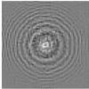

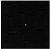

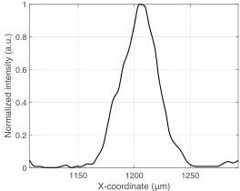

Fig. 3. Experimental data of single-spot focusing. (a) Hologram. (b) Its reproduced pattern. (c) Line profile of the spot. Hologram (phase) pattern is normalized in the interval [-π, π].

In the second experiment, image reproduction was demonstrated based on our method, as shown in Fig. 4. The three target intensity patterns ŷ shown in Fig. 4(a) were composed of a two-by-two array of digits, which were randomly selected from the handwritten digit data set of MATLAB. The holograms x̂ in Fig. 4(b) were calculated by the trained network with the target patterns. Their optically reproduced results are shown in Fig. 4(c). The zero-order light was not observed. A dot-array-like artifact in Fig. 4(c) may have been caused by the Talbot effect of the wiring grid used for pixel-wise control of the liquid crystal on the SLM and is not speckle noise [4]. It might be possible to alleviate this with an SLM having a larger fill factor, such as a reflective SLM. The root mean squared error (RMSE) between the target intensity patterns in Fig. 4(a) and the reproduced results with the proposed method in Fig. 4(c) was 0.16. The holograms calculated based on the GS method are shown in Fig. 4(d). The GS method is a representative iterative algorithm for calculating CGHs, and the number of iterations in the experiment was set to 100 [10]. The optically reproduced results are shown in Fig. 4(e). The RMSE between the target patterns in Fig. 4(a) and the reproduced results with the GS method in Fig. 4(e) was 0.17. Therefore, the reproduced results of our method were comparable with those of the conventional method.

Computational times for calculating a single hologram based on our method and the GS method were 26 and 94 ms, respectively, when using a computer with an Intel Core i7 processor with a clock rate of 3.1 GHz and a memory size of 16 GB without any parallelization or a graphics processing unit. Therefore, our method calculates holograms with a

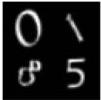

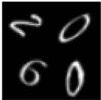

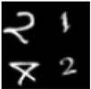

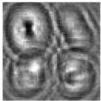

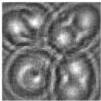

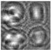

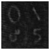

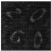

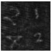

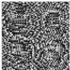

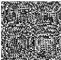

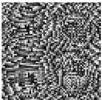

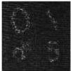

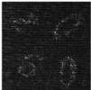

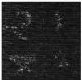

Fig. 4. Experimental data of image reproduction. (a) Target intensity patterns. (b) Holograms based on the proposed method and (c) their reproduced patterns. (d) Holograms based on the GS method and (e) their reproduced patterns. Hologram (phase) patterns are normalized in the interval [-π, π]. The reproduced patterns were normalized with the same light intensity value.

shorter computational time compared with the conventional iterative method. The training time in our method was 40 h.

The relationship between the number of training pairs and the focusing performance at different hologram sizes was numerically investigated by simulating the first experiment, as shown in Fig. 5. The number of training pairs was set to 1000, 10,000, and 100,000. The pixel counts (N²) of the holograms and target patterns were set to 16², 32², and 64². The other parameters and the procedures for training the networks and calculating the holograms were the same as those in the first experimental demonstration. The reproduced focusing patterns