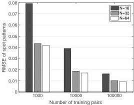

3862

Vol. 57, No. 14 / 10 May 2019 / Applied Optics

Research Article

Fig. 5. Relationship between the number of training pairs and the RMSE in a focusing simulation.

were computationally calculated with Fresnel propagation. The focusing performance was evaluated with the RMSEs between the target and the numerically reproduced focusing patterns, as shown in Fig. 5. This result shows that a larger hologram and a larger number of training data sets provide better performance.

## 4. CONCLUSION

In this paper, we proposed a noniterative method for calculating CGHs based on a convolutional deep neural network. The network was regressed to the inverse process of the optical propagation with a number of speckle pairs. We experimentally demonstrated a phase-only CGH based on our method. The results were compared with those obtained with the GS method. The demonstrations showed reasonable image quality of the reproduced intensity pattern and a shorter computational time for the proposed method compared with the conventional one.

We used the network shown in Fig. 2(a) for calculating the CGH in this paper. Deep neural networks have many options and tuning parameters [36]. Further investigation of the network architecture is needed for improving the performance. In this paper, we demonstrated control of 2D intensity with a phase-only CGH using visible light. Our method is readily extendable to various wave fields, e.g., x-rays and acoustic waves, and higher-dimensional pattern shaping, such as 3D spatial focusing, multispectral (color) holography, and temporal pulse shaping. It is also applicable to simultaneous holographic control of the complex amplitude (both amplitude and phase) and amplitude-only/complex-amplitude CGHs. Therefore, the proposed technique is promising in various applications, including biomedical sensing/control, industrial engineering, and entertainment.

Funding. Japan Society for the Promotion of Science (JSPS) (JP17H02799, JP17K00233); Precursory Research for Embryonic Science and Technology (PRESTO) (JPMJPR17PB).

## REFERENCES

1. B. R. Brown and A. W. Lohmann, "Complex spatial filtering with binary masks," Appl. Opt. 5, 967–969 (1966).

2. W. H. Lee, "Sampled Fourier transform hologram generated by computer," Appl. Opt. 9, 639–643 (1970).

3. D. Leseberg and C. Frère, "Computer-generated holograms of 3-D objects composed of tilted planar segments," Appl. Opt. 27, 3020–3024 (1988).

4. J. W. Goodman, Introduction to Fourier Optics (McGraw-Hill, 1996).

5. G. Nehmetallah and P. P. Banerjee, "Applications of digital and analog holography in three-dimensional imaging," Adv. Opt. Photon. 4, 472–553 (2012).

6. C. Slinger, C. Cameron, and M. Stanley, "Computer-generated holography as a generic display technology," Computer 38, 46–53 (2005).

7. J. Geng, "Three-dimensional display technologies," Adv. Opt. Photon. 5, 456–535 (2013).

8. K. Dholakia and T. Čižmár, "Shaping the future of manipulation," Nat. Photonics 5, 335–342 (2011).

9. J. A. Rodrigo and T. Alieva, "Freestyle 3D laser traps: tools for studying light-driven particle dynamics and beyond," Optica 2, 812–815 (2015).

10. R. W. Gerchberg and W. O. Saxton, "A practical algorithm for the determination of the phase from image and diffraction plane pictures," Optik 35, 237–246 (1972).

11. J. Bengtsson, "Kinoform design with an optimal-rotation-angle method," Appl. Opt. 33, 6879–6884 (1994).

12. N. Yoshikawa, M. Itoh, and T. Yatagai, "Quantized phase optimization of two-dimensional Fourier kinoforms by a genetic algorithm," Opt. Lett. 20, 752–754 (1995).

13. T. Dresel, M. Beyerlein, and J. Schwider, "Design of computer-generated beam-shaping holograms by iterative finite-element mesh adaption," Appl. Opt. 35, 6865–6874 (1996).

14. T. G. Jabbour and S. M. Kuebler, "Vectorial beam shaping," Opt. Express 16, 7203–7213 (2008).

15. A. W. Lohmann and D. P. Paris, "Binary Fraunhofer holograms, generated by computer," Appl. Opt. 6, 1739–1748 (1967).

16. P. W. M. Tsang and T. C. Poon, "Novel method for converting digital Fresnel hologram to phase-only hologram based on bidirectional error diffusion," Opt. Express 21, 23680–23686 (2013).

17. P. W. M. Tsang, Y.-T. Chow, and T. C. Poon, "Generation of phase-only Fresnel hologram based on down-sampling," Opt. Express 22, 25208–25214 (2014).

18. T. Shimobaba and T. Ito, "Random phase-free computer-generated hologram," Opt. Express 23, 9549–9554 (2015).

19. T. Ando, R. Horisaki, and J. Tanida, "Speckle-learning-based object recognition through scattering media," Opt. Express 23, 33902–33910 (2015).

20. R. Horisaki, R. Takagi, and J. Tanida, "Learning-based imaging through scattering media," Opt. Express 24, 13738–13743 (2016).

21. R. Takagi, R. Horisaki, and J. Tanida, "Object recognition through a multi-mode fiber," Opt. Rev. 24, 117–120 (2017).

22. R. Horisaki, R. Takagi, and J. Tanida, "Learning-based focusing through scattering media," Appl. Opt. 56, 4358–4362 (2017).

23. R. Horisaki, R. Takagi, and J. Tanida, "Learning-based single-shot superresolution in diffractive imaging," Appl. Opt. 56, 8896–8901 (2017).

24. A. Sinha, J. Lee, S. Li, and G. Barbastathis, "Lensless computational imaging through deep learning," Optica 4, 1117–1125 (2017).

25. Y. Rivenson, Z. Göröcs, H. Günaydin, Y. Zhang, H. Wang, and A. Ozcan, "Deep learning microscopy," Optica 4, 1437–1443 (2017).

26. M. Lyu, W. Wang, H. Wang, H. Wang, G. Li, N. Chen, and G. Situ, "Deep-learning-based ghost imaging," Sci. Rep. 7, 17865 (2017).

27. Y. Jo, S. Park, J. Jung, J. Yoon, H. Joo, M.-H. Kim, S.-J. Kang, M. C. Choi, S. Y. Lee, and Y. Park, "Holographic deep learning for rapid optical screening of anthrax spores," Sci. Adv. 3, e1700606 (2017).

28. S. Yamauchi, Y.-W. Chen, and Z. Nakao, "Optimization of computer-generated holograms by an artificial neural network," in Proceedings of Second International Conference on Knowledge-Based Intelligent Electronic Systems (KES'98) (Cat. No. 98EX111) (IEEE, 1998), Vol. 3, pp. 220–223.