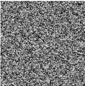

## Метод Герчберга-Сэкстона

Метод Герчберга-Сэкстона (ГС) – это итеративный метод для синтеза фазового ДОЭ, формирующего заданное распределение интенсивности когерентного монохроматического света в некоторой плоскости. На рис. 1.2 представлен киноформ, синтезированный с использованием метода Герчберга-Сэкстона, и изображение, восстановленное с него.

(а)

(б)

Рис. 1.2. ДОЭ, синтезированный методом Герчберга-Сэкстона, (а) и изображение, восстановленное с него (б)

Схему метода можно описать следующим образом: выбор первоначального приближения фазы и выполнение заданного количества итераций метода. Каждая итерация метода включает следующие шаги:

1. Расчёт распространения светового поля из плоскости ДОЭ в плоскость восстановленного изображения; замена рассчитанного распределения амплитуды в плоскости восстановленного изображения на заданное.
2. Расчёт распространения светового поля из плоскости восстановленного изображения в плоскость ДОЭ; замена амплитудного распределения во всём поле в плоскости ДОЭ на единицу.

11