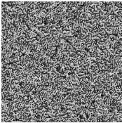

Распределения фазы в плоскостях восстановленного изображения и ДОЭ не подвергаются изменению. После осуществления заданного количества итераций ДОЭ считается синтезированным.

Метод Герчберга-Сэкстона – классический алгоритм, обладающий свойством невозрастания ошибки при увеличении числа итераций. После выполнения определённого числа итераций достигается стагнация.

### Метод Герчберга-Сэкстона с весовыми коэффициентами

Метод Герчберга-Сэкстона с весовыми коэффициентами [6] является модификацией метода Герчберга-Сэкстона. На рис. 1.3 представлен ДОЭ, синтезированный с использованием метода Герчберга-Сэкстона с весовыми коэффициентами, и изображение, восстановленное с него.

(а)

(б)

Рис. 1.3. ДОЭ, синтезированный методом Герчберга-Сэкстона с весовыми коэффициентами, (а) и изображение, восстановленное с него (б)

Первые несколько итераций реализуются по классической схеме Герчберга-Сэкстона. После определённого количества итераций амплитуда полученного распределения в плоскости восстановленного изображения $A_n[\xi, \eta]$ перестает заменяться на распределение амплитуды по исходному объекту $A_0[\xi, \eta]$ и начинает определяться выражением:

$$A_n[\xi, \eta] = \alpha_n A_0[\xi, \eta] \quad (1.4)$$

12