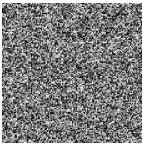
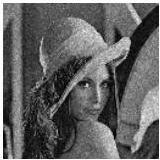

где  \( [\xi,\eta] \)  - дискретные координаты в плоскости восстановленного изображения, n - номер итерации,  \( \alpha_{n} \)  - весовой коэффициент, определяющийся из рекуррентного соотношения:

\[
\alpha_ {n} = \alpha_ {n - 1} \beta_ {n - 1} (n > 1), \tag {1.5}
\]

\[
\beta_ {n} = \frac {A _ {0} [ \xi , \eta ]}{A _ {n - 1} [ \xi , \eta ] + \varepsilon}, \tag {1.6}
\]

где  \( \varepsilon \)  – число порядка  \( 10^{-10} \) ,  \( \alpha_{1}=1 \) . Система весовых коэффициентов нормируется на единицу.

Метод Герчберга-Сэкстона с весовыми коэффициентами обеспечивает лучший результат восстановления по сравнению с классическим алгоритмом, т.к. дополнительно добавляется система весовых коэффициентов, являющаяся объектно-зависимым амплитудным фильтром, меняющимся в процессе итераций.

### Метод Фьенапа

В методе Фьенапа [7] синтез ДОЭ проводится только путём изменения интенсивности получаемого распределения в плоскости восстановления изображения. На рис. 1.4 представлен ДОЭ, синтезированный с использованием метода Фьенапа, и изображение, восстановленное с него.

(a)

(6)

Рис. 1.4. ДОЭ, синтезированный методом Фьенапа, (а) и изображение, восстановленное с него (б)

13