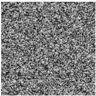
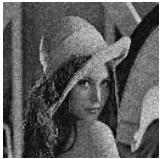

После выбора начального приближения комплексной амплитуды в плоскости ДОЭ выполняется некоторое количество итеративных шагов. N-ая итерация метода включает следующие шаги:

1. Распространение волны из плоскости ДОЭ до плоскости восстановленного изображения.
2. Изменение полученной комплексной амплитуды  \( A_{n-1}[\xi,\eta] \)  путём добавления функции  \( \Delta A_{n-1}[\xi,\eta] \) , зависящей от  \( A_{n-1}[\xi,\eta] \)  и распределения амплитуды по исходному объекту:

\[
A _ {n} [ \xi , \eta ] = A _ {n - 1} [ \xi , \eta ] + \gamma \cdot \Delta A _ {n - 1} [ \xi , \eta ], \tag {1.7}
\]

где γ – число от 0,5 до 1 включительно.

3. Распространение волны из плоскости восстановленного изображения до плоскости ДОЭ.

Данный метод также имеет название «алгоритм входа-выхода».

Особенностью метода Фьенапа является ярко выраженная зависимость результата восстановления от начального приближения фазы.

#### Адаптивно-аддитивный метод

Адаптивно-аддитивный [8] метод основывается на методе ГС. На рис. 1.5 представлен ДОЭ, синтезированный с использованием адаптивно-аддитивного метода, и изображение, восстановленное с него.

(a)

(6)

Рис. 1.5. ДОЭ, синтезированный с использованием адаптивно-аддитивного метода, (а) и изображение, восстановленное с него (б)

14