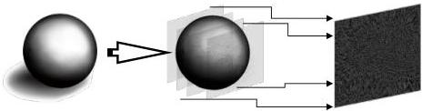

Рис. 1.6. Принципиальная схема метода суперпозиций

Исходное трехмерное распределение разбивается на плоскости, далее от каждой плоскости рассчитывается фазовый ДОЭ, происходит суммирование элементарных ДОЭ. Расчет фазового ДОЭ производится согласно следующему выражению:

$$\varphi = arg \left[ \sum_{z \in Z} \mathcal{T}_f^{-1} \mathcal{T}_z^{-1} \left[ \sqrt{V_z} \exp(j\varphi_z) \right] \right] \quad (1.9)$$

где $\mathcal{T}_f^{-1}$ – функция, описывающая обратное распространение от плоскости восстановления до фурье-плоскости, $\mathcal{T}_z^{-1}$ – функция, описывающая обратное распространение поля между плоскостями объектов, $V_z$ – сечение плоской сцены на расстоянии $z$, $\varphi_z$ – случайная фаза, соответствующая распределению в плоскости $V_z$.

Метод является неитеративным, поэтому расчет производится быстро, несмотря на рост времени расчета в зависимости от числа плоскостей. Неитеративность метода суперпозиции ограничивает точность восстановления. Информация о фазовой составляющей не является полной, так как амплитуда изображения отбрасывается на последнем шаге метода – перед вычислением фазы. Это ведет к потере информации об объекте.

### Последовательный метод «пинг-понг»

Метод «пинг-понг» [9] был предложен для синтеза ДОЭ объемных сцен, позволяющих восстанавливать «плоские» сфокусированные изображения в различных сечениях этих объемных сцен. В его основе лежит расчет

16