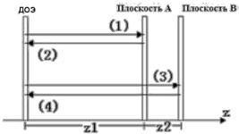

распределения уже ставшим стандартным методом Герчберга-Сэкстона [1]. Схема последовательного метода «пинг-понга» представлена на рис. 1.7.

Рис. 1.7. Схема последовательного метода «пинг-понг»

ДОЭ, синтезируемый последовательным методом «пинг-понг», воспроизводит несколько сфокусированных распределений интенсивности на разных расстояниях. Вначале производится расчет распространения излучения от ДОЭ до плоскости $A$ и обратно, далее излучение распространяется до плоскости $B$ и обратно, тогда как в классическом методе «пинг-понг» распределение интенсивности рассчитывается непосредственно между плоскостями восстановления.

Таким образом, последовательный метод «пинг-понг» является итеративным методом синтеза ДОЭ для восстановления трехмерных сцен – каждая итерация включает в себя расчет излучения от ДОЭ до всех плоскостей сцены.

### Глобальный метод «пинг-понг»

Глобальный метод «пинг-понга» [11] основан на тех же принципах, что и последовательный метод. На рис.1.8 представлена классическая схема расчета ДОЭ методом «глобальный пинг-понг».

17