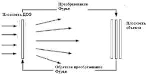

Рис. 1.8. Схема метода «глобальный пинг-понг»

Расчет распространения излучения и применение амплитудных и фазовых ограничений производятся одновременно для всех сечений объемной сцены, соответствующих сфокусированным изображениям объектов. Глобальный метод «пинг-понг» позволяет синтезировать ДОЭ для объемной сцены, состоящей из набора плоских объектов. Так же метод «глобальный пинг-понг» позволяет уменьшить влияние спеклов в области восстанавливаемого изображения.

Глобальный метод «пинг-понг», также являясь итеративным методом синтеза ДОЭ, но, в отличие от последовательного метода «пинг-понг», позволяет усреднять вклады интенсивности от всех плоскостей на каждой своей итерации.

### **Метод на основе невыпуклой оптимизации**

Метод на основе невыпуклой оптимизации [19] позволяет вносить изменения в значения фазы, когда невозможно точно удовлетворить всем ограничениям интенсивности. На рис. 1.9 представлена схема расчета ДОЭ методом на основе невыпуклой оптимизации.

18