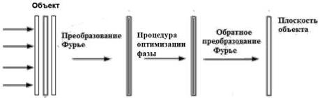

Рис. 1.9. Схема расчета ДОЭ методом на основе невыпуклой оптимизации

Начальная фаза может быть набором случайных значений или может быть получена с использованием любого метода. Для более гибкого изменения параметров ДОЭ, а именно значения фазы, формулируется задача оптимизации:

\[
\varphi^ {*} = \arg \min _ {\varphi} L (I (\varphi), V), \tag {1.10}
\]

где  \( I(\varphi) \)  – интенсивность трехмерного изображения V, разбитого на плоские сцены, с фазой  \( \varphi \) , выведенной на ПВМС, и весовой функцией L, определяемой пользователем. В качестве объекта минимизации используется следующая весовая функция:

\[
L (I, V) = \sum L _ {1} (I (x, y, z)) + \sum L _ {2} (I (x, y, z)), \tag {1.11}
\]

где  \( L_{1} \)  и  \( L_{2} \)  являются весовыми функциями для темных и светлых пикселей соответственно.

Расчет весовой функции для светлых пикселей производится следующим образом:

\[
L _ {1} = \left\{ \begin{array}{c c} (I - l ^ {2}), & \text { если } I > l \\ 0, & \text { если } I <   l \end{array} \right. \tag {1.12}
\]

где I – интенсивность трехмерного изображения, l – пороговое значение интенсивности, задаваемое пользователем.

Для решения задачи оптимизации используется квазиньютоновский метод [25, 26]. Квазиньютоновский метод – метод оптимизации, основанный

19