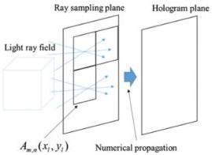

Рис. 1.10. Расчет голограммы проекционным методом

Относительно центра каждой из элементарных голограмм  \( A_{m,n}(x_{l}, y_{l}) \)  проекция объемного объекта умножается на случайное распределение фаз, где  \( (x_{l}, y_{l}) \)  – координаты в элементарной голограмме относительно её центра в  \( (x, y) = (ms, ns) \) . От произведения проекции объемного объекта и случайного распределение фаз рассчитывается фурье-образ. Получается набор угловых спектров объемной сцены – итоговая голограмма  \( L(x = ms, y = ns) \) . Значение для элементарной голограммы представлено следующим выражением:

\[
\begin{array}{l} A _ {m, n} (x _ {l}, y _ {l}) = \iint L (m s, n s; \theta_ {x}, \theta_ {y}) e x p [ j \varphi (\theta_ {x}, \theta_ {y}) ] \\ \times \exp \left[ - j \frac {2 \pi}{\lambda} \left(\theta_ {x} x _ {l} + \theta_ {y} y _ {l}\right) \right] d \theta_ {x} d \theta_ {y} \\ \end{array}
\]

(1.15)

где  \( \theta_{x},\theta_{y} \)  представлены в радианах,  \( \varphi(\theta_{x},\theta_{y}) \)  – случайное фазовое распределение в пределах  \( [0,2\pi] \) . Затем излучение, прошедшее через эту плоскость, распространяется в плоскость итоговой голограммы [22].

Проекционный метод синтеза дифракционных элементов является высокоэффективным, но при этом и чрезвычайно ресурсоёмким методом и требует серьезной обработки входных данных объемных изображений, поэтому в рамках работы рассматриваться не будет.

21