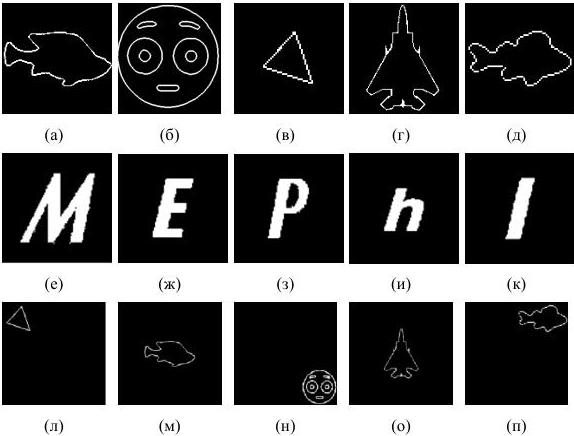

## Глава 2. Численные эксперименты по синтезу ДОЭ и восстановлению объемных сцен

С использованием высокоуровневой среды программирования MATLAB был проведен синтез ДОЭ методами, отобранных по результатам анализа, представленного в главе 1, а также численное моделирование восстановления изображений с полученных ДОЭ.

### 2.1 Условия численного моделирования

Для численного синтеза ДОЭ и моделирования восстановления объемных сцен были использованы три набора бинарных изображений. В первых двух (рис 2.1(а-д), (е-л) изображения располагались по центру рабочей области, в третьем (рис.2.1(л-п) изображения располагались в различных участках рабочей области. Изображения имеют размер 200×200 пикселей каждое. Такой размер изображения был выбран для минимизации времени расчета.

Рис. 2.1. Исходные бинарные изображения

23