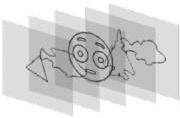
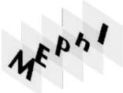
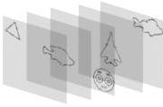

На основе данных изображений различными методами были синтезированы ДОЭ. Синтезированные ДОЭ обладали следующими характеристиками: размер ДОЭ составляет $300 \times 300$ пикселей, размер пикселя ДОЭ – $8 \text{ мкм} \times 8 \text{ мкм}$, длина волны излучения лазера, использованного при записи, составляла 561 нм, расстояние от объекта до ДОЭ варьируется.

Из объектов, представленных на рис. 2.1, были сформированы наборы объемных сцен: первый и третий наборы содержали в себе контурные изображения (рис. 2.1(а, в), а второй – буквы «М», «Е», «Р», «h» и «I» (рис. 2.1(б)). Сформированные наборы объемных сцен представлены на рис. 2.2. Для наглядности объекты представлены с инвертированной яркостью.

(а)

(б)

(в)

Рис. 2.2. Наборы объёмных сцен

Была проанализирована зависимость качества изображений, восстановленных с ДОЭ, синтезированных выбранными методами, от количества плоскостей в объемной сцене. Критерием оценки качества был выбран коэффициент корреляции по Пирсону:

$$K = \frac{\sum(X - \bar{X})(Y - \bar{Y})}{\sqrt{\sum(X - \bar{X})^2 \sum(Y - \bar{Y})^2}} \quad (2.1)$$

где $X, Y$ – значение интенсивности в сравниваемых изображениях, $\bar{X}, \bar{Y}$ – средние значения интенсивностей для сравниваемых изображений.

24