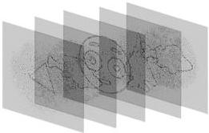
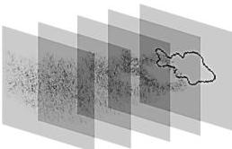
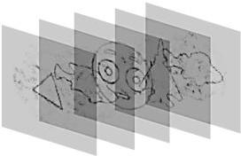
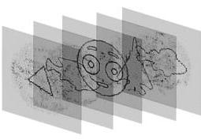

Значения коэффициента корреляции лежат в пределах от -1 до +1. При этом значение -1 будет говорить об инверсии между изображениями, 0 - о нулевой корреляции, а +1 - о полной корреляции изображений, т.е., о полном их совпадении. Чем ближе значение коэффициента корреляции к +1, тем сильнее связь между двумя случайными величинами.

## 2.2 Случай объектов, расположенных в центре рабочей области

Объекты, восстановленные с ДОЭ, синтезированных выбранными методами, на основе сцены, состоящей из набора контурных изображений, представлены на рис. 2.3. Для наглядности объекты представлены с инвертированной яркостью.

(а)

(б)

(в)

(г)

Рис. 2.3. Объекты, восстановленные с ДОЭ, синтезированных методами: (а) суперпозиций, (б) последовательным «пинг-понг», (в) глобальным метод «пинг-понг», (г) на основе невыпуклой оптимизации

25