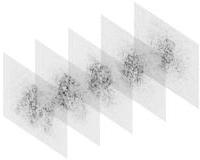
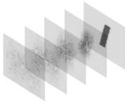
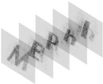
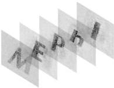

(а)

(б)

(в)

(г)

Рис. 2.4. Объекты, восстановленные с ДОЭ методами: (а) суперпозиций, (б) последовательным «пинг-понг», (в) глобальным метод «пинг-понг», (г) на основе невыпуклой оптимизации

Табл. 2.2. Значение среднего коэффициента корреляции для изображений

|  Метод | суперпозиций | последовательный «пинг-понг», | глобальный метод «пинг- понг» | на основе невыпуклой оптимизации  |
| --- | --- | --- | --- | --- |
|  Средний коэффициент корреляции | 0,29 | 0,22 | 0,63 | 0,71  |

Для отобранных многоплоскостных методов была исследована зависимость коэффициента корреляции от числа плоскостей в

27