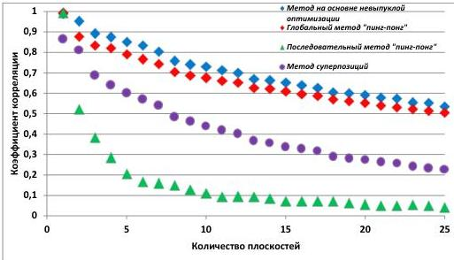

восстановленном изображении. В качестве исходного объекта использовалась сцена на рис. 2.2 (б).

Результат эксперимента по исследованию зависимости коэффициента корреляции от количества плоскостей представлен на рис. 2.5.

Рис. 2.5. Зависимость коэффициента корреляции от количества плоскостей

По качеству восстановления оптимальным методом для синтеза ДОЭ является метод на основе невыпуклой оптимизации. Среднее значение коэффициента корреляции для метода на основе невыпуклой оптимизации превышает среднее значение коэффициента корреляции для глобального метода «пинг-понг» на 7%, для последовательного метода «пинг-понг» - на 652%, для метода суперпозиций – на 82%.

Была проанализирована зависимость времени синтеза ДОЭ выбранными методами от количества плоскостей в объемной сцене. В качестве исходного объекта использовалась сцена с рис. 2.2(а), продублированная 5 раз на 25 плоскостей.

Результат эксперимента по исследованию зависимости времени расчета ДОЭ от количества плоскостей в объемной сцене представлен на рис. 2.6.

28