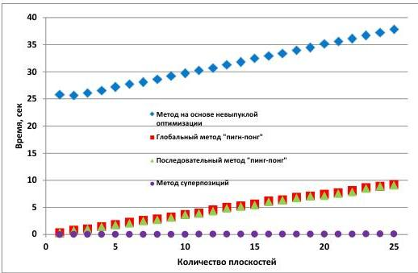

Рис. 2.6. Зависимость времени расчета ДОЭ от количества плоскостей в объемной сцене

Метод суперпозиции является наименее ресурсоёмким: время расчета ДОЭ для одной плоскости составляет 0,01 с, для 25 плоскостей – 0,12 с. Наиболее ресурсоёмкий метод – это метод на основе невыпуклой оптимизации, для которого время расчета для одной плоскости составляет 25 с, для 25 плоскостей – 38 с.

29