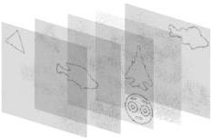
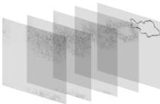
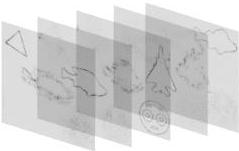
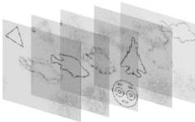

## 2.3 Случай объектов, расположенных в разных участках рабочей области

Для уменьшения паразитного межплоскостной интерференции объекты были разнесены в различные участки рабочей области. Данное паразитное влияние проявляется в «лишних белых» пикселях в поле восстановленного объекта.

### 2.3.1 Результаты численного моделирования восстановления изображений с ДОЭ, синтезированных многоплоскостными методами

Объекты, восстановленные с ДОЭ, синтезированных выбранными методами, на основе сцены, состоящей из набора контурных изображений, представлены на рис. 2.7.

(а)

(б)

(в)

(г)

Рис. 2.7 Объекты, восстановленные с ДОЭ методами: (а) суперпозиций, (б) последовательным «пинг-понг», (в) глобальным метод «пинг-понг», (г) на основе невыпуклой оптимизации

30