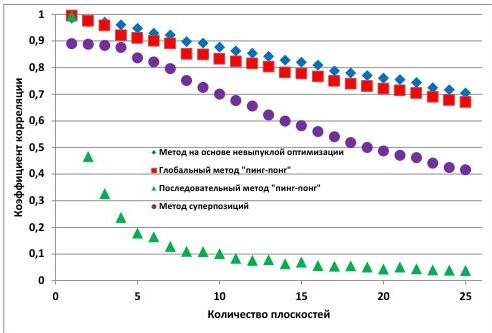

Рис. 2.8. Зависимость коэффициента корреляции от количества плоскостей

По качеству восстановления оптимальным методом для синтеза ДОЭ является метод на основе невыпуклой оптимизации. Среднее значение коэффициента корреляции для метода на основе невыпуклой оптимизации превышает среднее значение коэффициента корреляции для глобального метода «пинг-понг» на 4,5%, для последовательного метода «пинг-понг» - на 981%, для метода суперпозиций – на 36%.

Для объемной сцены с рис. 2.2(в) зависимость времени синтеза ДОЭ выбранными методами от количества плоскостей в объемной сцене не была рассмотрена. Время расчета ДОЭ не зависит от поперечного размера сечения записываемого объекта и его положения в рабочей области. Поэтому зависимость времени расчета ДОЭ от количества плоскостей в объемной сцене будет совпадать с зависимостью, представленной на рис. 2.5.

### 2.3.2 Результаты численного моделирования восстановления изображений с ДОЭ, синтезированных поточечными методами

Объекты, восстановленные с ДОЭ, синтезированных поточечным методом, на основе сцены, состоящей из набора контурных изображений

32