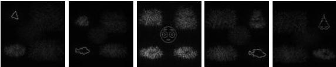

(рис. 2.1(в)), представлены на рис. 2.9. Как видно, изображения в каждой плоскости визуально различимы.

Рис. 2.9. Срезы объемного объекта, восстановленного с ДОЭ, синтезированного поточечным методом

Для объектов, представленных на рис. 2.9, был рассчитан коэффициент корреляции исходного и восстановленных изображений согласно выражению (2.1). Результаты представлены в таблице 2.4.

Табл. 2.4. Значение коэффициента корреляции для изображений

|  Номер плоскости объемного объекта | 1 | 2 | 3 | 4 | 5  |
| --- | --- | --- | --- | --- | --- |
|  Средний коэффициент корреляции | 0,95 | 0,93 | 0,92 | 0,95 | 0,93  |

На рис. 2.10 представлено изменение степени фокусировки изображения, восстанавливаемого с ДОЭ, в зависимости от расстояния до данного ДОЭ для третьей плоскости объемного объекта.

33