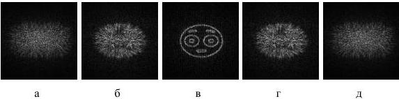

Рис. 2.10. Изменение степени фокусировки изображения, восстанавливаемого с ДОЭ, в зависимости от расстояния до данного ДОЭ (для расстояний: 9 см (а), 10 см (б), 11 см (в), 12 см (г), 13 см (д))

Как видно, изображение сфокусировано (четкое), если восстановление происходит на расстоянии синтеза ДОЭ для данной плоскости (см. рис.2.10(в), и расфокусировано для остальных расстояний (см. рис.2.10(а,б,г,д)).

# Выводы главы 2.

1. Проведен синтез фазовых ДОЭ объемных объектов отобранными методами и численные эксперименты по восстановлению объемных объектов с них.
2. Для многоплоскостных методов по качеству восстановления трехмерных сцен, содержащих объекты в центре рабочей области, оптимальным является метод на основе невыпуклой оптимизации. Среднее значение коэффициента корреляции для метода на основе невыпуклой оптимизации превышает среднее значение коэффициента корреляции для глобального метода «пинг-понг» на 7%, для последовательного метода «пинг-понг» - на 652%, для метода суперпозиций – на 82%.
3. Метод суперпозиции является самым быстрым методом, время расчета ДОЭ для одной плоскости составляет 0,01с, для 25 плоскостей – 0,12 с. Самый медленный метод – метод на основе невыпуклой оптимизации,

34