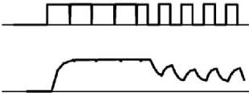

Instantaneous  
Liquid Crystal  
RMS voltage

Liquid Crystal response

Рис. 3.1. Профиль управляющего напряжения и отклик ячейки ЖК

В зависимости от максимального количества адресуемых уровней фазы для каждой конфигурации управляющих сигналов меняется частота адресации в модуляторе. Чем меньше уровней фазы, тем выше частота адресации и тем меньше размах временных флуктуаций фазы [27].

Наличие фазовых флуктуаций приводит к снижению качества изображений, оптически восстановленных с голограмм. Для устранения негативных эффектов флуктуации фазы возможна их компенсация. Для этого необходимо измерение зависимости фазового сдвига от уровня сигнала и времени от начала показа кадра до момента его регистрации фотосенсором.

### 3.2 Измерение фазового сдвига в ЖК ПВМС

В данной работе исследовался фазовый ЖК ПВМС HoloEye PLUTO VIS, работающий в режиме «на отражение» и имеющий следующие характеристики: число элементов — $1920 \times 1080$, размер элемента — $8 \times 8$ мкм, частота смены кадров — 60 Гц, число уровней сигнала — 256 (8 бит). Для измерения фазового сдвига ПВМС использовался двухлучевой интерференционный метод [28]. На рис. 3.2 представлена схема экспериментальной установки для измерения фазового сдвига ПВМС.

37