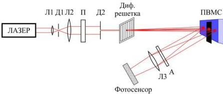

Рис. 3.2. Схема экспериментальной установки для измерения фазового сдвига ПВМС

Источником излучения являлся оптоволоконный лазер с длиной волны 561 нм. Излучение лазера фильтруется и расширяется линзами Л1, Л2 и диафрагмой Д1. Далее пучок ограничивается диафрагмой Д2 и попадает на дифракционную решётку. Дифракционная решетка расположена так, что на модулятор попадают первый и минус первый порядки дифракции, а нулевой порядок дифракции блокируется экраном в плоскости модулятора. Анализатор А пропускает свет с горизонтальной поляризацией. Микроскоп Л3 участвует в увеличении и построении изображения интерференционной картины в плоскости фотосенсора камеры.

Для измерения величины временных фазовых флуктуаций использовалась синхронизация ПВМС и камеры. Синхронизация необходима для того, чтобы камера, регистрирующая поле восстановленного изображения, снимала кадры через один и тот же промежуток времени по отношению к началу показа самого кадра на модуляторе. В результате получается, что для каждого изображения, что сняла камера, искажение за счёт флуктуаций фазы модулятора одно и то же.

Интерференционная картина регистрировалась камерой. При подаче различных уровней сигнала на половины экрана ЖК ПВМС изменяется величина фазового сдвига и, соответственно, положение интерференционных полос. По величине сдвига полос определяется величина фазового сдвига.

38