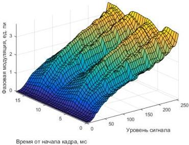

При измерении зависимости величины фазового сдвига от поданного сигнала и времени от начала кадра, уровень сигнала варьировался от 0 до 255 с шагом в 5 градаций, время от начала кадра изменялось в диапазоне от 0 до 17 мс с шагом 0,5 мс. При каждом фиксированном значении уровня сигнала и временной задержки снималось по 4 изображения интерференционной картины, далее находился усреднённый снимок. Величина смещения определялась корреляционным методом. Зависимость фазового сдвига от уровня сигнала и времени от начала кадра приведена на рис. 2.3.

Рис. 3.3. Зависимость фазового сдвига от уровня сигнала и времени от начала кадра

Значение максимальной глубины фазовой модуляции составило $(3,58\pm0,05)\pi$.

На основании данной зависимости (рис. 3.3) была модифицирована работа модулятора для повышения качества восстановления изображений с его использованием, а именно на основании полученной зависимости создана калибровочная кривая для ЖК ПВМС, которая обеспечивает линейность модулятора при его работе в режиме синхронизации с камерой или лазером.

39