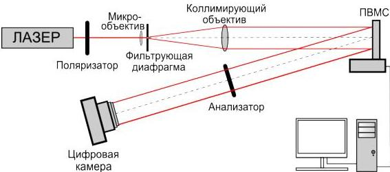

## Глава 4. Оптические эксперименты по восстановлению объемных сцен с ДОЭ, синтезированных различными методами

Результаты численного моделирования необходимо было апробировать оптическими экспериментами. Для этого была собрана экспериментальная установка с использованием ЖК ПВМС и выведены ДОЭ, содержащие различные объемные сцены.

### 4.1 Условия проведения оптического эксперимента

Принципиальная схема оптического эксперимента по восстановлению изображений с ДОЭ, выводимых на ПВМС, представлена на рис. 4.1.

Рис. 4.1. Принципиальная схема оптического эксперимента по восстановлению изображений с ДОЭ, выводимых на ПВМС

В данной схеме источник излучения – волоконный иттербиевый лазер IPG-Photonics VLM-561-3 мощностью до 3 Вт и длиной волны 561 нм – освещает систему из микрообъектива, фильтрующей диафрагмы и коллимирующего объектива. Функции данной системы: коллимация лазерного пучка и его низкочастотная пространственная фильтрация. Пучок отражается от фазового модулятора света HoloEye PLUTO VIS (разрешение $1920 \times 1080$ пикселей, размер пикселя 8 мкм $\times 8$ мкм), на котором отображается ДОЭ. Далее излучение проходит через анализатор на фотосенсор камеры. Для съемки объемного изображения использовалась

41